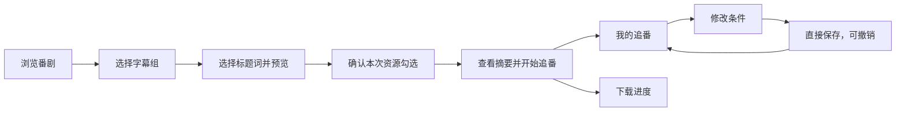
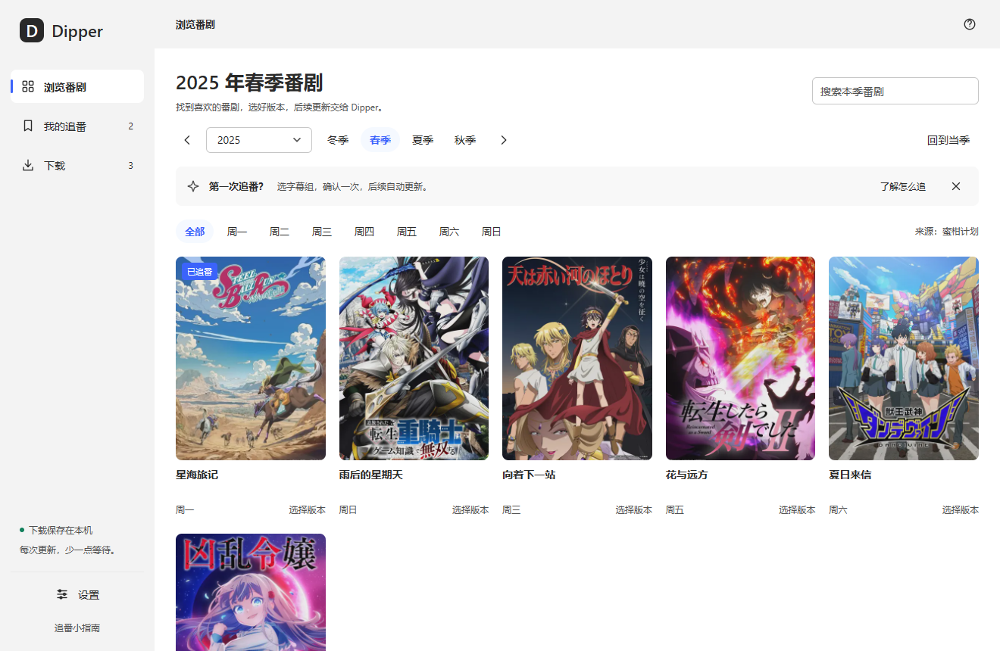
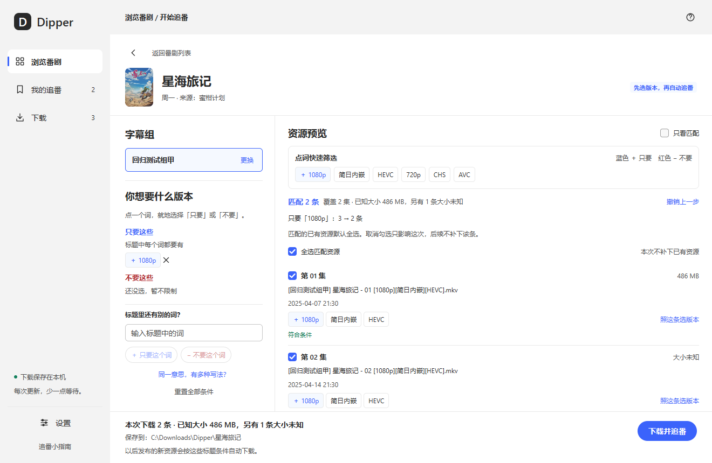

# Dipper V1 Prototype Design

- Date: 2026-10-22
- Status: the user has approved the current prototype; this document fixes the visual and interaction baseline confirmed in this round.
- User: desktop users new to automatic anime following who are unfamiliar with RSS, BT, and regular expressions.
- Design direction: Adobe Spectrum visual system + interaction principles from the Apple Human Interface Guidelines.
- Implementation direction: MyGo Native UI + Go; see [docs/architecture.md](docs/architecture.md) for the decisions behind the stack and what would reopen them.
- Requirements basis: [PRD-v1.md](PRD-v1.md). This document specifies how the UI expresses existing product behavior; the PRD is authoritative for business semantics. See Section 10 for the prototype demo scope.

## 1. Experience goals

Let users first find an anime they like, then understand what they will download, and after a single confirmation wait for updates with confidence.

First use requires no RSS URL, no external downloader configuration, and no understanding of codec terminology. Users choose conditions themselves and results appear as they act; experiments can be undone. Visual hierarchy is organized around posters, original titles, match results, and the current primary action.

| Principle | Concrete requirement |
| --- | --- |
| Browse first, choose later | The app opens on the anime catalog; plugins and the download core are not first-run configuration steps. |
| Selection and result visible together | Version preferences are edited on the left while original titles and match reasons show on the right; multi-word selection does not cover the results. |
| Unambiguous actions | Uses 只要 (Only) / 不要 (Don't) / 不限 (Any) instead of requiring users to remember one global include or exclude pattern. |
| Safe experimentation | Conditions support repeated undo and redo; ordinary saves can be undone, avoiding repeated confirmation. |
| Feedback near the action | Shows changes in match counts, the direction of the current condition, the release being referenced, and save results. |
| Motion serves comprehension | Short transitions explain state changes; respects the reduce-motion preference. |

## 2. Information architecture and core flow

The main navigation is fixed to 浏览番剧 (Browse anime) / 我的追番 (My follows) / 下载 (Downloads), with Settings and the follow guide at the bottom of the sidebar. Anime details belong to the browse flow and add no separate navigation item.

| Page | User's question | Main content and actions |
| --- | --- | --- |
| 浏览番剧 (Browse anime) | What do I want to follow? | Year, season, weekday, search, poster grid. |
| 番剧详情 (Anime details) | Which version do I want? | Fansub group, title conditions, release preview, download summary for this run. |
| 我的追番 (My follows) | Is my anime updating normally? | Saved conditions, pause/resume, edit conditions, latest check result. |
| 下载 (Downloads) | How are the downloads going? | Total speed, per-release progress and speed, pause/resume/retry, seeding state. |
| 设置 (Settings) | Where are the files, and how does the app run? | Download root, shared upload limit, reduce motion, background and exit behavior. |



## 3. Page designs

### 3.1 Browse anime

The top shows the year and season being browsed under an explicit heading, for example 「2026 年秋季番剧」 (2026 Fall anime). Year, season, previous/next season, and back to the current season form one filter area; switching seasons across a year boundary updates the year too. Search applies to the current season, and the weekday filter can return to All.

Posters are the main browsing entry point, paired with the anime name, update weekday, and an entry to choose a version. Followed items carry a status marker. The poster grid shows three to six columns depending on available width, names wrap to at most two lines, and the list position is preserved when returning from details.

Onboarding hints use a collapsible, lightweight hint bar; the guide opens only when the user asks for it. A failing source shows a retry entry, an empty search offers to clear filters, and seasons not loaded in the prototype state their sample scope explicitly.



### 3.2 Anime details and release preview

```text
┌─────────────────────────────┬─────────────────────────────────────────────────────────────────────────────────────────┐
│ 固定导航 (Fixed navigation) │ 返回列表 / 海报 / 番名 / 来源  (Back to list / Poster / Title / Source)                 │
│                             ├─────────────────────────────────────┬───────────────────────────────────────────────────┤
│                             │ 字幕组 (Fansub group)               │ 资源预览 (Release preview)                        │
│                             │                                     │ 快速筛选词 (Quick filter words)                   │
│                             │ 你想要什么版本 (Which version)      │ 匹配数量 / 撤销 / 重做 (Match / Undo / Redo)      │
│                             │ 条件或多词选择 (Conditions / words) │ 原标题 / 勾选 / 匹配原因 (Title / Check / Reason) │
│                             │ 独立滚动 (Scrolls separately)       │ 独立滚动 (Scrolls separately)                     │
│                             ├─────────────────────────────────────┴───────────────────────────────────────────────────┤
│                             │ 本次资源摘要 / 文件夹 / 当前主操作  (Releases this run / Folder / Primary action)       │
└─────────────────────────────┴─────────────────────────────────────────────────────────────────────────────────────────┘
```

Entering details does not preselect a fansub group. Before one is chosen, the version area explains what a fansub group is and the right side prompts for a choice. Once selected, the fansub group collapses to a single row that keeps a 「更换」 (Change) entry; switching to another group clears the current title conditions and rebuilds release selection and filter history.

The top of the right side summarizes candidate words available in original titles, including words that only appear further down the list, such as 「合集」 (collection/batch). Users need not scroll to a specific release before setting an exclusion. The release list keeps non-matching items visible with reasons by default and can be toggled to 「只看匹配」 (Only matching).

Each release keeps its original title, recognized episode number, size, candidate words, and match reason. Original titles can be copied. Different releases of the same episode are listed separately, with 「本集匹配 N 条」 (N matches for this episode) prompting users to check the differences.

### 3.3 My follows

Each follow shows the poster, anime name, fansub group, saved conditions, run state, latest check result, and folder. It supports pausing/resuming the follow, editing conditions, and checking now.

Pausing a follow stops only new-release checks; downloads already submitted and their seeding keep running. After saving conditions the result appears inline in the list with an 「撤销保存」 (Undo save) action; undo restores only the previous fansub group and rules and keeps any pause state, checks, and download records that happened afterwards. This undo entry belongs to the current session and is not a cross-restart version history feature.

### 3.4 Downloads

Uses a release list. The header shows total download speed and total upload speed separately; each release shows its original title, folder, progress, size, current download and upload speeds, and the action matching its state.

| Release state | Visible feedback | Primary action |
| --- | --- | --- |
| 下载中 (Downloading) | Progress, downloaded size, download and upload speeds | 暂停 (Pause) |
| 已暂停 (Paused) | Explicit paused state | 继续 (Resume) |
| 连接失败 (Connection failed) | A comprehensible reason and a note that progress is kept | 重试 (Retry) |
| 已完成、做种中 (Completed, seeding) | Upload speed, share ratio, cumulative seeding time | 停止做种 (Stop seeding) |
| 已完成、停止做种 (Completed, seeding stopped) | Completed and stopped state | 查看保存位置 (Show save location) |

The global upload limit defaults to 1 MB/s and is shared by all tasks. After completion, seeding stops once the share ratio reaches 1:1 or effective seeding accumulates 1 hour; stopping seeding manually does not delete files. Business boundaries for real transfer and timing follow the PRD; progress and speeds in the prototype are simulated data.

### 3.5 Settings and desktop lifecycle

Settings are grouped by appearance, download location, upload sharing, and window and background running. Changing the global root affects only new subscriptions; existing anime keep their original folders and files are never moved automatically.

The title bar and window content share one light appearance, keeping system window buttons, dragging, and double-click maximize/restore. Closing the window sends it to the tray; 「保存并完全退出」 (Save and quit completely) stops the program. Background running does not require the user to stay on the details page.

Prototype experience tools sit in their own group; the shipping product does not expose simulated failures, simulated completion, or resetting experience data as everyday actions.

## 4. Title filtering interaction spec

### 4.1 Click a word, choose a direction explicitly

1. Clicking a candidate word opens only the choice panel next to that word and adds no default condition.
2. The panel shows 「只要含这个词的」 (Only with this word) / 「不要含这个词的」 (Without this word), each previewing the remaining release count after applying it.
3. Choosing immediately updates conditions, match reasons, release counts, and the download summary, then collapses the panel.
4. An existing restriction offers 「不再限制这个词」 (No longer restrict this word), and can also be removed directly from the selected conditions.
5. Clicking outside or pressing Esc without choosing closes the panel and changes no condition.

A blue plus pairs with 只要 (Only) and a red minus with 不要 (Don't); direction is expressed by text, symbol, and color at once. Changing direction replaces the original condition so the same word is never both required and excluded.

### 4.2 Choose a version from this release

Clicking 「照这条选版本」 (Choose version from this release) on a release switches the version area on the left to that title's candidate words, each offering 不限／＋只要／−不要 (Any / + Only / − Don't). The source release shows 「正在参考」 (Referencing), and the list, quick filters, and checkboxes on the right stay usable.

Multiple words can be chosen in sequence, and each choice updates the match results immediately. Clicking 「完成选版本」 (Finish version selection) or pressing Esc returns to normal condition editing and keeps the current draft. Episode numbers never enter the suggestions; opening the panel alone neither copies every word nor creates a subscription.



### 4.3 Custom words and alternative spellings

The input field offers 「＋只要这个词」 (+ Only this word) and 「−不要这个词」 (− Don't use this word). Typing text alone does not decide the condition's direction, and blank input cannot be added.

「同一意思，有多种写法？」 (Same meaning, several spellings?) is collapsed by default. When expanded, spellings can be separated with `/`, for example `简日内嵌 / CHS`, forming one any-of group; saved groups are always visible and can be removed.

### 4.4 Matching rules

| User expression | Exact meaning |
| --- | --- |
| 只要这些 (Only these) | The title must contain every selected word. |
| 不要这些 (Not these) | A title containing any excluded word does not match. |
| 这些写法，有一个就行 (Any of these spellings) | At least one word from each group must appear; multiple groups must each be satisfied. |
| 没选任何条件 (No conditions selected) | Every release in the group matches. |
| 只设置排除词 (Only exclusions set) | Titles that do not contain any excluded word also match. |

Matching is textual against the original title and never inferred from downloaded video content. ASCII matching is case-insensitive, and full-width ASCII matches half-width; no automatic simplified/traditional conversion or synonym expansion is performed. Resolution, codec, and subtitle tags aid reading only and must not silently add download restrictions.

Example: 只要 `1080p` (Only 1080p), 只要 `简日内嵌` (Only simplified Chinese hard-sub), 不要 `合集` (Don't use 合集) means the title contains both of the first two words and not 合集; it does not mean the user must understand HEVC or AVC to make the choice.

### 4.5 Experimentation, undo, and feedback

The current draft supports repeated undo and redo, showing the specific action and the match count after restoring, for example 「已撤销只要『1080p』· 匹配 8 条」 (Undid Only '1080p' · 8 matches). Button tooltips state which condition will be undone or redone. Adding a new condition after undoing ends the old redo branch.

On Windows, Ctrl+Z undoes and Ctrl+Y or Ctrl+Shift+Z redoes. Inside an input field, text undo takes priority and does not also roll back filter rules. Switching fansub groups or reopening an anime starts a new filter history.

On zero matches, explain the result directly, suggest removing keywords or checking the actual spelling, and keep the adjust and undo entries; never interrupt experimentation with a blocking error.

## 5. This run's downloads and future following

These two kinds of choice must be expressed separately: title conditions decide which future releases may download, while checkboxes decide which existing releases are submitted now. Unchecking changes no title condition.

All existing matching releases are checked by default, and multiple versions of one episode are never silently reduced to one. Users can uncheck items one by one, select all matching releases, or choose 「本次不补下已有资源」 (Don't backfill existing releases this time). Non-matching releases cannot be checked.

| Scenario | Primary button | Result |
| --- | --- | --- |
| New follow, with releases this run | 下载并追番 (Download and follow) | Opens the summary showing fansub group, rules, count, size, and folder. |
| Summary, with releases this run | 下载 N 条并追番 (Download N and follow) | Confirms this selection and saves the conditions for future following. |
| New follow, no releases this run | 开启自动追番 (Enable auto-follow) | After summary confirmation, saves future following only. |
| Back from summary to edit | 返回调整 (Back to adjust) | Keeps the draft and checkboxes. |
| Edit an existing follow | 保存追番条件 (Save follow conditions) | Saves directly with inline feedback, and the save can be undone. |

Editing existing rules does not resubmit read or skipped releases; the release preview serves to observe future matching behavior and is not an implicit historical backfill. Duplicate RSS entries are deduplicated by release identity, and different releases of the same episode can be downloaded separately.

## 6. Visual spec

### 6.1 Color

| Purpose | Value | Boundary of use |
| --- | --- | --- |
| Window bar and sidebar | `#f3f3f3` | Forms the unified window shell. |
| Content layer | `#ffffff` | Main reading area for posters, releases, and details. |
| Secondary background | `#f8f8f8` | Lightweight hints and supporting areas. |
| Subtle divider | `#e9e9e9` | Separates areas and release rows. |
| Control outline | `#c6c6c6` | Input fields and secondary buttons. |
| Body text and headings | `#292929` | Headings and body share one neutral family. |
| Secondary text | `#505050` | Descriptions, paths, and metadata. |
| Primary accent / 只要 (Only) | `#3b63fb` | Primary buttons, selection, focus, and include conditions. |
| Accent tint | `#f5f9ff` | Lightweight selected background. |
| Exclude condition | `#b1262b` / `#fff5f5` | Red text and tint, paired with a minus sign and explicit wording. |
| Success / notice | `#12805c` / `#9c5700` | Paired with text explaining match, completion, and multiple versions of the same episode. |

The primary accent hover color is `#274dea` and the pressed color is `#1d3ecf`. Ordinary headings, help text, and release rows stay restrained; poster hover does not change title color.

### 6.2 Type, sizing, and layout

The Windows prototype uses the Segoe UI, Microsoft YaHei UI font stack. Body text is 14 DIP, supporting notes 12 DIP, release status and small badges 11 DIP, section headings 18 DIP, the browse heading 26 DIP, and the anime detail heading 23 DIP; hierarchy relies mainly on size and weight.

| Element | Current baseline |
| --- | --- |
| Initial / minimum window size | 1320 × 900 / 1040 × 720 DIP |
| Top bar / sidebar / detail condition column | 64 / 204 / 306 DIP |
| Common spacing | Based on 4 DIP; 8, 12, 16, 24, and 28 are common. |
| Primary and secondary button / input / poster corner radius | 20 / 6 / 8 DIP |
| Standard icon button / sidebar navigation height | 32 × 32 / 44 DIP |
| Poster grid | Three to six columns, 18 DIP horizontal gap and 24 DIP vertical gap. |

The primary action is pinned to the bottom of details; conditions and releases scroll separately. When long titles wrap or truncate, the full text stays accessible, and long file names are never squeezed into the primary action. The window title area reserves space for system controls.

## 7. Motion and input spec

| Interaction | Parameters and behavior |
| --- | --- |
| Button hover / press | 130ms, color feedback, pressing scales to 0.97. |
| Poster hover | 190ms, lifts 3 DIP and scales to 1.008; pressing settles it back. |
| Page transition | 190ms, fade-in with slight movement. |
| Word popover / dialog | 160ms, appears and disappears locally. |
| Conditions, releases, and counts | 190ms, expresses changes in conditions and counts. |
| Simulated download progress | Interpolates over 400ms between updates for smooth continuity. |

Easing uses `cubic-bezier(0, 0, .4, 1)`. When in-app reduce motion or the equivalent system preference is on, the target state appears directly; no animation frames are requested after a transition ends.

Every action has explicit text or an accessibility name, and icon buttons provide tooltips. Keyboard focus feedback and native control keyboard behavior are preserved; Esc first closes the current local choice, and the initial confirmation can be cancelled. Shortcuts on other platforms follow each platform's conventions and must be implemented and verified separately.

## 8. Errors and copy

| Situation | UI handling |
| --- | --- |
| Source unreachable | States the failure and offers retry, keeping existing follows and download records. |
| Empty search | Explains the current filter scope and offers clearing filters. |
| Episode or subtitles not recognized in the title | Shows the original title and unknown fields, and still allows text filtering. |
| Title conditions match nothing | Shows the reason and how to adjust, without pretending downloadable releases exist. |
| Multiple versions of one episode | Shows the count explicitly and lets users narrow conditions or keep several. |
| Download failed | Shows the reason and a retry entry, keeping existing progress. |
| State write failed | Shows the save failure; a success message must never stand in for a failed result. |

Fixed terminology is 浏览番剧 (Browse anime), 字幕组 (Fansub group), 只要 (Only), 不要 (Don't), 不限 (Any), 资源预览 (Release preview), 我的追番 (My follows), 下载 (Downloads), 暂停追番 (Pause follow), and 暂停下载 (Pause download). RSS, BT, regular expressions, and plugin details stay where a technical question needs explaining.

## 9. Acceptance baseline

| ID | Observable result |
| --- | --- |
| U01 | After browsing by year, season, weekday, or search, entering details and returning preserves the browse conditions and list position. |
| U02 | Clicking a word opens direction selection only; cancelling applies no condition; both directions preview the remaining release count. |
| U03 | Selecting 只要 1080p, 只要 简日内嵌, and 不要 合集 in sequence updates counts, reasons, and the summary together. |
| U04 | While choosing a version from a release, releases and quick filters on the right remain operable; collapsing the panel keeps the choice. |
| U05 | No rules matches everything; exclusions only, multiple required words, and any-of groups behave as defined in Section 4. |
| U06 | Repeated undo, redo, and branch updates behave correctly; undo inside an input field does not also change rules. |
| U07 | Different releases of the same episode are kept; unchecking one changes no condition, and saving does not backfill it automatically. |
| U08 | A new follow explicitly confirms count, size, rules, and folder; cancelling confirmation keeps the draft. |
| U09 | Editing conditions saves directly without resubmitting existing tasks; undoing a save does not roll back pause state that happened afterwards. |
| U10 | Pausing a follow does not stop existing downloads; pausing downloads does not change follow rules. |
| U11 | Changing the root moves no existing anime; closing the window sends it to the tray, and quitting completely stops running. |
| U12 | Key actions are reachable at three test window sizes; animation stops after short transitions, and reduce motion takes effect immediately. |

These are design acceptance criteria; the actual execution level and untested scope follow in the next section, and a passing prototype is not acceptance of the shipping core or of all three platforms.

## 10. Deliverables and verification boundaries

| Deliverable | Location |
| --- | --- |
| Launch | [启动入口 (launch entry)](start.cmd), [程序 (program)](bin/dipper.exe), [使用说明 (usage guide)](README.md) |
| Page images | [浏览 (Browse)](evidence/ui/01-browse.png), [筛选 (Filtering)](evidence/ui/02-filter.png), [追番 (Following)](evidence/ui/03-following.png), [下载 (Downloads)](evidence/ui/04-downloads.png), [设置 (Settings)](evidence/ui/05-settings.png), [来源故障 (Source error)](evidence/ui/06-source-error.png), [补下 (Backfill)](evidence/ui/07-backfill.png) |
| Subsystem pages | [docs/subsystems/](docs/subsystems/README.md) |

The shipping program uses MyGo v0.5.5 and Go 1.27.1, and stores follow rules, read/skipped records, and download state in SQLite. Source verification samples come from the 2026-10-21 Mikan fall snapshot; the boundaries of real RSS, BT downloads and the native UI are in [README.md](README.md#verification-and-boundaries).

`scripts/build.ps1 -Test -Render` covers UI regression, `go vet`, the build, and native view screenshots. The real Windows window has been checked for in-place version selection, match-count feedback, and repeated undo and redo; screenshots are generated from the same native views and cannot replace acceptance of system windows, input methods, or actual rendering performance.

The app connects to real RSS and the built-in BT downloader. macOS/Linux, real input method candidates, sustained frame rate, and install/distribution are outside this version's acceptance conclusions.

## 11. Design sources

- [Adobe Spectrum 2 color tokens](https://opensource.adobe.com/spectrum-design-data/tokens/color-palette/) and [Spectrum Motion](https://spectrum.adobe.com/page/motion/): native visual parameters and short transitions for this project.
- [Apple HIG Modality](https://developer.apple.com/design/human-interface-guidelines/modality): modal tasks should have clear benefit and avoid interrupting the current context.
- [Apple HIG Alerts](https://developer.apple.com/design/human-interface-guidelines/alerts): reduce interruptions for common, undoable actions.
- [Apple HIG Undo and redo](https://developer.apple.com/design/human-interface-guidelines/undo-and-redo): support repeated undo to help users understand results.
- [Apple HIG Popovers](https://developer.apple.com/design/human-interface-guidelines/popovers): show a small number of related options nearby to keep context.

These are interaction principles and visual references. This project implements a native theme in Go; it does not use Adobe React/Web Components directly and does not imply adoption of Apple platform components.
