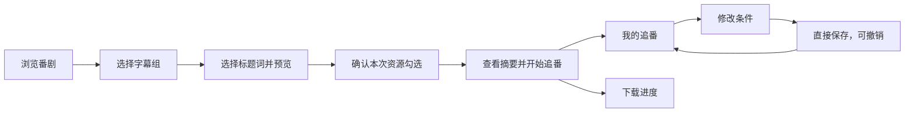

# Dipper V1 原型设计方案

- 日期：2026-10-22
- 状态：用户已认可当前原型；本方案固化本次确认的视觉与交互基线。
- 用户：初次接触自动追番，不熟悉 RSS、BT 和正则表达式的桌面用户。
- 设计方向：Adobe Spectrum 视觉体系 + Apple 人机交互指南的交互原则。
- 实现方向：MyGo Native UI + Go；具体技术决策见 [TECH-STACK-v1.md](TECH-STACK-v1.md)。
- 需求依据：[PRD-v1.md](PRD-v1.md)。本文规定界面如何表达既有产品行为，业务语义以 PRD 为准；原型演示范围见第 10 节。

## 1. 体验目标

让用户先找到喜欢的番剧，再看得懂自己会下载什么，确认一次后安心等待更新。

首次使用不要求填写 RSS 地址、配置外部下载器或理解编码术语。条件由用户主动选择，结果随操作出现；试错可以撤销。视觉层级围绕海报、原标题、匹配结果和当前主操作组织。

| 原则 | 具体要求 |
| --- | --- |
| 先浏览，再选择 | 默认进入番剧目录；插件和下载内核不成为首次配置步骤。 |
| 选择与结果同时可见 | 左侧编辑版本偏好，右侧展示原标题和匹配原因；多词选择不遮住结果。 |
| 操作含义明确 | 使用「只要／不要／不限」，不要求记住一个全局包含或排除模式。 |
| 允许安全试错 | 条件支持连续撤销与重做；普通保存可撤销，避免重复确认。 |
| 反馈贴近动作 | 显示匹配数量变化、当前条件方向、正在参考的资源及保存结果。 |
| 动效服务理解 | 用短过渡说明状态改变；遵循减少动态效果偏好。 |

## 2. 信息架构与核心流程

主导航固定为「浏览番剧／我的追番／下载」，设置与追番指南位于侧栏底部。番剧详情属于浏览流程，不增加独立导航项。

| 页面 | 用户的问题 | 主要内容与操作 |
| --- | --- | --- |
| 浏览番剧 | 我想追什么？ | 年份、季度、星期、搜索、海报列表。 |
| 番剧详情 | 我想要哪个版本？ | 字幕组、标题条件、资源预览、本次下载摘要。 |
| 我的追番 | 我的番在正常更新吗？ | 保存条件、暂停／恢复、修改条件、最近检查结果。 |
| 下载 | 文件下载得怎么样？ | 总速度、单资源进度和速度、暂停／继续／重试、做种状态。 |
| 设置 | 文件在哪里，软件怎样运行？ | 下载根目录、共享上传上限、减少动态效果、后台与退出说明。 |



## 3. 页面方案

### 3.1 浏览番剧

顶部展示当前浏览的年份和季度，使用明确标题，例如「2026 年秋季番剧」。年份、季度、上一季／下一季及回到当季构成同一筛选区域；跨年切季同步更新年份。搜索针对当前季度，星期筛选可回到全部。

海报是主要浏览入口，配番名、更新星期和选择版本入口。已追番项目有状态标记。海报网格按可用宽度显示三至六列，番名最多两行，返回详情前的列表位置保持不变。

新手提示使用可收起的轻量提示条；指南由用户主动打开。来源失败显示重试入口，搜索无结果提供清除筛选；原型未载入的季度明确说明其样例范围。


### 3.2 番剧详情与资源预览

```text
┌───────────┬──────────────────────────────────────────┐
│ 固定导航  │ 返回列表 / 海报 / 番名 / 来源             │
│           ├───────────────┬──────────────────────────┤
│           │ 字幕组        │ 资源预览                 │
│           │               │ 快速筛选词               │
│           │ 你想要什么版本│ 匹配数量 / 撤销 / 重做    │
│           │ 条件或多词选择│ 原标题 / 勾选 / 匹配原因  │
│           │ 独立滚动      │ 独立滚动                 │
│           ├───────────────┴──────────────────────────┤
│           │ 本次资源摘要 / 文件夹 / 当前主操作       │
└───────────┴──────────────────────────────────────────┘
```

进入详情不预选字幕组。尚未选择时，在版本区域说明字幕组的作用，右侧引导选择。选中后将字幕组收为一行，保留「更换」入口；更换到另一组会清空当前标题条件、重建资源选择及筛选历史。

右侧顶部汇总原标题中可用的候选词，包括列表下方才出现的词，例如「合集」。用户无需先滚到某条资源才能设置排除条件。资源列表默认保留不匹配项并显示原因，可切换「只看匹配」。

每条资源保留原标题、可识别集数、大小、候选词与匹配原因。原标题可选择复制。相同集数的不同资源分别展示，以「本集匹配 N 条」提醒用户检查差异。

### 3.3 我的追番

每条追番展示海报、番名、字幕组、已保存条件、运行状态、最近检查结果和文件夹。支持暂停／恢复追番、修改条件和立即检查。

暂停追番只停止检查新资源，已经提交的下载与做种继续运行。保存条件后在列表内显示结果，提供「撤销保存」；撤销只恢复之前的字幕组和规则，保留之后发生的暂停状态、检查与下载记录。该撤销入口属于当前运行会话，不作为跨重启的历史版本功能。

### 3.4 下载

采用资源列表。页头分别显示总下载速度和总上传速度；每个资源展示原标题、文件夹、进度、大小、当前下载与上传速度，以及与状态对应的操作。

| 资源状态 | 可见反馈 | 主要操作 |
| --- | --- | --- |
| 下载中 | 进度、已下载大小、下载与上传速度 | 暂停 |
| 已暂停 | 明确暂停状态 | 继续 |
| 连接失败 | 可理解的原因与保留进度的说明 | 重试 |
| 已完成、做种中 | 上传速度、分享比例、累计做种时间 | 停止做种 |
| 已完成、停止做种 | 完成与停止状态 | 查看保存位置 |

全局上传上限默认 1 MB/s，所有任务共享。完成后达到分享比例 1:1 或累计有效做种 1 小时即停止；手动停止做种不删除文件。真实传输与计时的业务边界沿用 PRD，原型中的进度和速度属于模拟数据。

### 3.5 设置与桌面生命周期

设置按外观、下载位置、上传分享、窗口与后台运行分组。修改全局根目录只影响新订阅；已有番剧保留原文件夹，不自动搬动文件。

顶栏与窗口内容采用统一浅色外观，保留系统窗口按钮、拖动及双击最大化／还原。关闭窗口收进托盘；「保存并完全退出」停止程序。后台运行不要求用户停留在详情页。

原型体验工具单独分组，正式产品不以模拟故障、模拟完成和重置体验数据作为日常操作入口。

## 4. 标题筛选交互规范

### 4.1 点一个词，明确选择方向

1. 点击候选词，只打开该词旁的选择面板，不添加任何默认条件。
2. 面板展示「只要含这个词的／不要含这个词的」，分别预览应用后剩余资源数。
3. 选择后立即更新条件、匹配原因、资源数和下载摘要，并收起面板。
4. 已有限制可选择「不再限制这个词」，也可以从已选条件中直接移除。
5. 未作选择时点击外部或按 Esc 关闭，不改变条件。

蓝色加号配「只要」，红色减号配「不要」；方向同时由文字、符号和颜色表达。改变方向时替换原条件，避免同一词同时被要求包含和排除。

### 4.2 照这条选版本

点击某条资源的「照这条选版本」，左侧版本区切换为这条标题的候选词，每个词提供「不限／＋只要／−不要」。来源资源显示「正在参考」，右侧列表、快速筛选和勾选继续可用。

允许连续选择多个词，每次选择即时更新匹配结果。点击「完成选版本」或按 Esc 返回普通条件编辑，保留当前草稿。集数不进入建议；打开面板本身不自动复制全部词、不创建订阅。


### 4.3 自定义词与多种写法

输入框旁分别提供「＋只要这个词」「−不要这个词」。只输入文字不决定条件方向，空白输入不可添加。

「同一意思，有多种写法？」默认收起。展开后可用 `/` 分开，例如 `简日内嵌 / CHS`，作为一组任意词条件；已保存的组始终可见并可移除。

### 4.4 匹配规则

| 用户表达 | 精确含义 |
| --- | --- |
| 只要这些 | 标题必须包含每一个所选词。 |
| 不要这些 | 标题包含任意一个排除词即不匹配。 |
| 这些写法，有一个就行 | 每组至少出现一个词；多组之间仍需逐组满足。 |
| 没选任何条件 | 该组所有资源匹配。 |
| 只设置排除词 | 没有写出排除词的标题也匹配。 |

对原标题做文字匹配，不根据下载后的视频内容推断。ASCII 大小写不敏感，全角 ASCII 按半角匹配；不自动做简繁转换或同义词扩展。清晰度、编码与字幕标签仅辅助阅读，不能暗加下载限制。

示例：只要 `1080p`、只要 `简日内嵌`、不要 `合集`，表示标题同时出现前两个词且不出现合集；并不表示用户必须理解 HEVC 或 AVC 才能完成选择。

### 4.5 试错、撤销与反馈

当前草稿支持连续撤销与重做，显示具体动作与恢复后的匹配数量，例如「已撤销只要『1080p』· 匹配 8 条」。按钮提示说明将撤销或重做哪个条件。撤销后添加新条件时，旧重做分支结束。

Windows 快捷键为 Ctrl+Z 撤销、Ctrl+Y 或 Ctrl+Shift+Z 重做。输入框内优先处理文字撤销，不同时回退筛选规则。更换字幕组或重新打开番剧开始新的筛选历史。

零匹配时直接解释结果，引导移除关键词或核对实际写法，保留调整与撤销入口；不以阻断式报错打断试选。

## 5. 本次下载与未来追番

这两类选择必须分别表达：标题条件决定未来什么资源可以下载；勾选决定本次提交哪些已有资源。取消勾选不改变标题条件。

已有匹配资源默认全部勾选，同集多版本不擅自只保留一条。用户可以逐条取消、全选匹配资源，或选择「本次不补下已有资源」。不匹配资源不可勾选。

| 场景 | 主按钮 | 结果 |
| --- | --- | --- |
| 新建，有本次资源 | 下载并追番 | 打开摘要，展示字幕组、规则、数量、大小与文件夹。 |
| 摘要，有本次资源 | 下载 N 条并追番 | 确认本次选择并保存后续追番条件。 |
| 新建，无本次资源 | 开启自动追番 | 摘要确认后，仅保存后续追番。 |
| 返回修改摘要 | 返回调整 | 保留草稿与勾选。 |
| 修改已有追番 | 保存追番条件 | 直接保存，行内反馈，可撤销保存。 |

修改已有规则不重新提交已读或已跳过的资源；资源预览用于观察未来匹配行为，不作为隐含的历史补下操作。重复 RSS 条目按资源身份去重，同集不同资源可分别下载。

## 6. 视觉规范

### 6.1 颜色

| 用途 | 色值 | 使用边界 |
| --- | --- | --- |
| 窗口栏与侧栏 | `#f3f3f3` | 形成统一窗口外壳。 |
| 内容层 | `#ffffff` | 海报、资源、详情的主阅读区域。 |
| 次级底色 | `#f8f8f8` | 轻量提示与辅助区域。 |
| 弱分隔线 | `#e9e9e9` | 区域与资源行分隔。 |
| 控件轮廓 | `#c6c6c6` | 输入框、次按钮。 |
| 正文与标题 | `#292929` | 标题与正文属于同一中性色系。 |
| 次级文字 | `#505050` | 说明、路径和元信息。 |
| 主强调／只要 | `#3b63fb` | 主按钮、选中、焦点与包含条件。 |
| 强调浅底 | `#f5f9ff` | 轻量选中背景。 |
| 排除条件 | `#b1262b` / `#fff5f5` | 红色文字及浅底，并配减号与明确文案。 |
| 成功／提醒 | `#12805c` / `#9c5700` | 配合文字解释匹配、完成及同集多个版本等状态。 |

主强调悬停色 `#274dea`，按压色 `#1d3ecf`。普通标题、帮助和资源行保持克制；海报悬停不改变标题颜色。

### 6.2 字体、尺寸与布局

Windows 原型使用 Segoe UI、Microsoft YaHei UI 字体栈。正文 14 DIP，辅助说明 12 DIP，资源状态和小徽标 11 DIP，区块标题 18 DIP，浏览标题 26 DIP，番剧详情标题 23 DIP；强调层级主要依靠字号和字重。

| 元素 | 当前基线 |
| --- | --- |
| 窗口初始尺寸／最小尺寸 | 1320 × 900 / 1040 × 720 DIP |
| 顶栏／侧栏／详情条件栏 | 64 / 204 / 306 DIP |
| 常用间距 | 以 4 DIP 为基础，常用 8、12、16、24、28。 |
| 主次按钮／输入框／海报圆角 | 20 / 6 / 8 DIP |
| 普通图标按钮／侧栏导航高度 | 32 × 32 / 44 DIP |
| 海报网格 | 三至六列，横向间距 18、纵向间距 24 DIP。 |

主操作固定在详情底部；条件与资源分别滚动。长标题换行或截断时保留原文访问方式，不将长文件名挤成主要操作。窗口标题区预留系统控件空间。

## 7. 动效与输入规范

| 交互 | 参数与表现 |
| --- | --- |
| 按钮悬停／按压 | 130ms，颜色反馈，按压轻缩至 0.97。 |
| 海报悬停 | 190ms，上移 3 DIP、轻缩放至 1.008；按下回落。 |
| 页面切换 | 190ms，淡入与小幅位移。 |
| 词语弹层／对话框 | 160ms，局部出现与消失。 |
| 条件、资源与计数 | 190ms，表现条件和数量变化。 |
| 模拟下载进度 | 更新间以 400ms 插值平滑衔接。 |

缓动使用 `cubic-bezier(0, 0, .4, 1)`。应用内减少动态效果或系统同类偏好开启时直接显示目标状态；过渡结束后不持续请求动画帧。

所有动作有明确文字或可访问性名称，图标按钮提供提示。保留键盘焦点反馈及原生控件键盘行为；Esc 优先关闭当前局部选择，首次确认可取消。其他平台的快捷键遵循对应平台习惯，需分别实现与验证。

## 8. 异常与文案

| 情况 | 界面处理 |
| --- | --- |
| 来源无法连接 | 明确失败并提供重试，保留已有追番与下载记录。 |
| 搜索无结果 | 说明当前筛选范围，提供清除筛选。 |
| 标题识别不出集数或字幕 | 展示原标题与未知信息，仍允许按文字筛选。 |
| 标题条件零匹配 | 显示原因与调整方向，不假装存在可下载资源。 |
| 同集多个版本 | 明确显示数量，允许用户自行缩小条件或保留多个。 |
| 下载失败 | 展示原因与重试入口，保留已有进度。 |
| 状态写入失败 | 展示保存失败信息，不能仅用成功提示代替失败结果。 |

常用术语固定为「浏览番剧、字幕组、只要、不要、不限、资源预览、我的追番、下载、暂停追番、暂停下载」。RSS、BT、正则表达式及插件细节留在需要解释技术问题的位置。

## 9. 验收基线

| 编号 | 可观察结果 |
| --- | --- |
| U01 | 浏览年份、季度、星期或搜索后，进入详情再返回，保持浏览条件与列表位置。 |
| U02 | 点词只打开方向选择；取消不应用条件；两个方向均预览剩余资源数。 |
| U03 | 连续选择只要 1080p、只要简日内嵌、不要合集，数量、原因与摘要同步更新。 |
| U04 | 照这条选版本时，右侧资源与快速筛选仍可操作；收起面板保留选择。 |
| U05 | 无规则全部匹配；仅排除、多个必需词、任意词组的含义与第 4 节一致。 |
| U06 | 连续撤销、重做及分支更新正确；输入框撤销不同时改变规则。 |
| U07 | 同集不同资源保留；取消一条不改变条件，保存后不会自动补下该条。 |
| U08 | 新建追番明确确认数量、大小、规则和文件夹；取消确认保留草稿。 |
| U09 | 修改条件直接保存，不重复提交已有任务；撤销保存不回滚后来发生的暂停状态。 |
| U10 | 暂停追番不停止已有下载；暂停下载不改变追番规则。 |
| U11 | 改根目录不搬动已有番剧；关闭窗口收进托盘，完全退出停止运行。 |
| U12 | 三种测试窗口尺寸内关键操作可达；短过渡结束后停止动画，减少动态效果立即生效。 |

这些是设计验收标准；实际执行层次和未测范围见下节，不能将原型通过视作正式内核或三端验收。

## 10. 交付物与验证边界

| 交付物 | 位置 |
| --- | --- |
| Windows MVP | [启动入口](start.cmd)、[程序](bin/dipper.exe)、[使用说明](README.md) |
| 页面图 | [浏览](evidence/ui/01-browse.png)、[筛选](evidence/ui/02-filter.png)、[追番](evidence/ui/03-following.png)、[下载](evidence/ui/04-downloads.png)、[设置](evidence/ui/05-settings.png)、[来源故障](evidence/ui/06-source-error.png)、[补下](evidence/ui/07-backfill.png) |
| MVP 验收 | [MVP-v1.md](MVP-v1.md) |

正式程序采用 MyGo v0.5.5、Go 1.27.1，并使用 SQLite 保存追番规则、已读／跳过记录和下载状态。来源验证样本来自 2026-10-21 蜜柑秋季快照；真实 RSS、BT 下载和原生界面的验证边界见 [MVP-v1.md](MVP-v1.md)。

`scripts/build.ps1 -Test -Render` 包含界面回归、`go vet`、构建与原生视图截图。真实 Windows 窗口已检查就地选版本、匹配数量反馈、连续撤销和重做；截图由同一原生视图生成，不能替代系统窗口、输入法与实际渲染性能验收。

MVP 已接入真实 RSS 与内置 BT 下载。macOS／Linux、真实输入法候选、持续帧率及安装分发不在本版验收结论内。

## 11. 设计来源

- [Adobe Spectrum 2 颜色 token](https://opensource.adobe.com/spectrum-design-data/tokens/color-palette/)与[Spectrum Motion](https://spectrum.adobe.com/page/motion/)：用于本项目的原生视觉参数和短过渡。
- [Apple HIG Modality](https://developer.apple.com/design/human-interface-guidelines/modality)：模态任务应收益明确，避免打断当前上下文。
- [Apple HIG Alerts](https://developer.apple.com/design/human-interface-guidelines/alerts)：减少常见、可撤销动作的打断。
- [Apple HIG Undo and redo](https://developer.apple.com/design/human-interface-guidelines/undo-and-redo)：支持连续撤销，帮助用户理解结果。
- [Apple HIG Popovers](https://developer.apple.com/design/human-interface-guidelines/popovers)：就近展示少量相关选项，保持上下文。

以上是交互原则与视觉参考。本项目以 Go 实现原生主题，未直接使用 Adobe React/Web Components，也不表示采用 Apple 平台组件。
