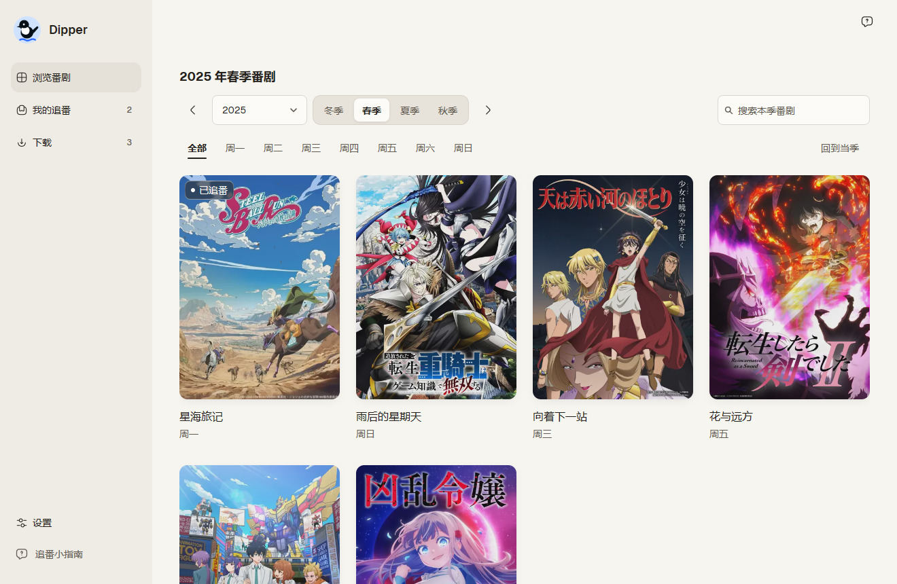
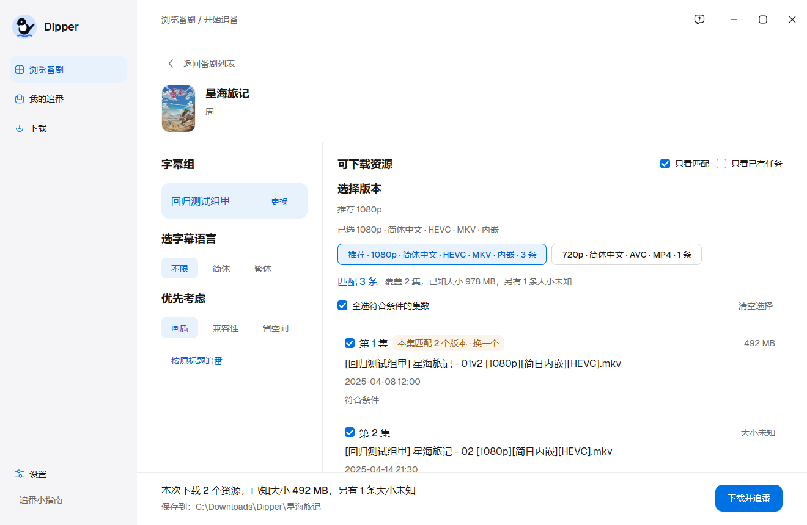
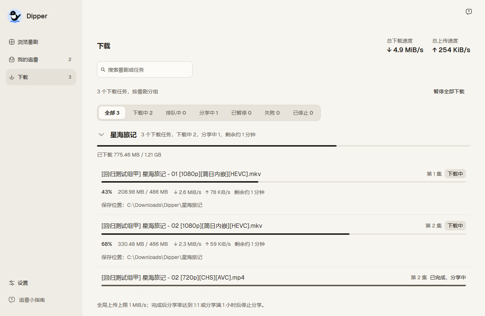
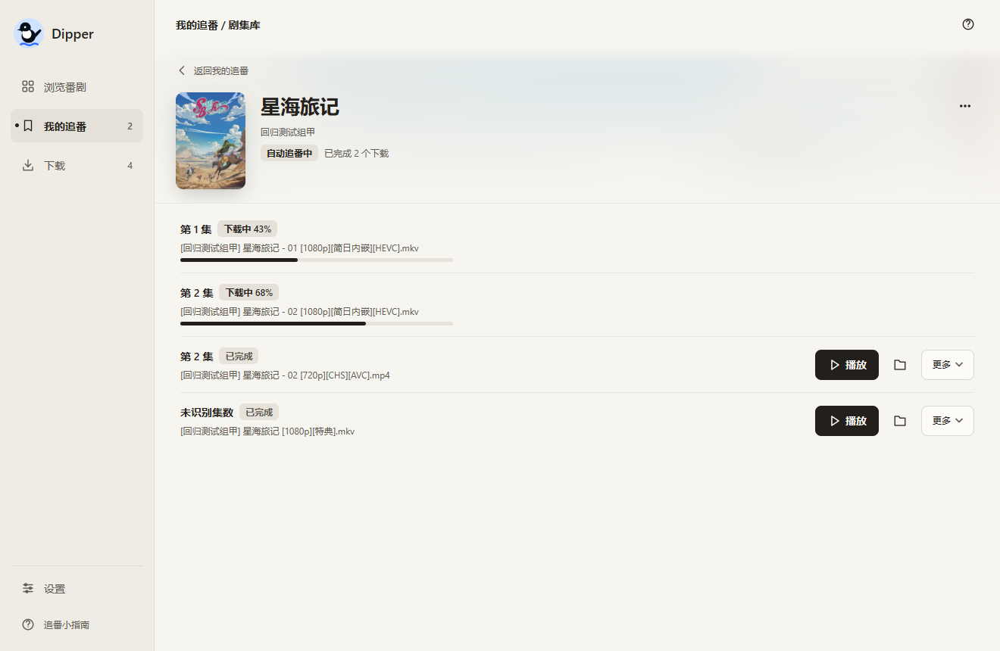

# Dipper

**A quiet, native desktop app for following and downloading anime from Mikan.**

**English** &nbsp;·&nbsp; [简体中文](README.zh-CN.md)

  
  
  
  
  

**[Download Latest](https://github.com/steampixel007/Dipper/releases/latest)** &nbsp;·&nbsp; [Highlights](#highlights) &nbsp;·&nbsp; [How It Works](#how-it-works) &nbsp;·&nbsp; [User Guide](docs/usage.md) &nbsp;·&nbsp; [Report an Issue](https://github.com/steampixel007/Dipper/issues)

 

<picture>
  <source media="(prefers-color-scheme: dark)" srcset="docs/assets/ui/01-browse-dark.png">
  <source media="(prefers-color-scheme: light)" srcset="docs/assets/ui/01-browse.png">
  
</picture>

Adaptive Light &amp; Dark interface rendered from Dipper's built-in sample catalog.

---

## Highlights

- **Single native binary** — Built with Go and [MyGo Native UI](https://github.com/egoist/mygo). No browser runtime, Node.js, or external BitTorrent client required.
- **Preference-driven version picking** — Choose subtitle language (`不限` / `简体` / `繁体`) and viewing priority (`画质` / `兼容性` / `省空间`) to get an automatic recommendation. Picks one release per episode, prefers revisions such as `01v2`, lets you switch any episode's version individually, and provides a keyword rule fallback (`按原标题追番`).
- **Built-in BitTorrent engine** — Polls followed feeds every 15 minutes with backoff retry. Supports download concurrency limits, a shared upload cap, configurable seeding time/ratio limits, custom proxies with authentication, and a built-in Tracker manager with online list import and XIU2 presets.
- **Organized library & quiet background mode** — Saves releases into structured `anime/group/` folders, opens completed episodes in your system media player, preserves download history even after unsubscribing, and stays out of the way in the system tray or macOS Dock.
- **Verified in-app updates** — Checks GitHub Releases on demand or daily, verifies packages against `SHA256SUMS`, and updates cleanly on restart.
- **Minimalist Light & Dark themes** — Neutral light, dark, and follow-system themes with reduced-motion support and full keyboard navigation.

## How It Works

### 1. Pick a fansub group and version

Browse Mikan by season, weekday, or title search. Opening a series defaults to the fansub group with the most releases, recommends a matching version based on your language and quality preferences, and previews every matched episode before you click **下载并追番** (Download and follow).

<picture>
  <source media="(prefers-color-scheme: dark)" srcset="docs/assets/ui/02-filter-dark.png">
  <source media="(prefers-color-scheme: light)" srcset="docs/assets/ui/02-filter.png">
  
</picture>

### 2. Automatic downloads under your control

While Dipper runs, new matching releases queue and download automatically. Track per-series and per-episode progress, transfer speeds, and seeding status on the **下载** (Downloads) page, or tune concurrency, upload limits, proxies, and Trackers in Settings.

<picture>
  <source media="(prefers-color-scheme: dark)" srcset="docs/assets/ui/04-downloads-dark.png">
  <source media="(prefers-color-scheme: light)" srcset="docs/assets/ui/04-downloads.png">
  
</picture>

### 3. Watch from your episode library

Open any followed series from **我的追番** (My Follows) to see all downloaded and active episodes. Click **播放** (Play) to open an episode in your system's media player, or use the **···** menu to backfill older releases, edit matching conditions, pause following, or open the series folder.

<picture>
  <source media="(prefers-color-scheme: dark)" srcset="docs/assets/ui/13-episode-library-dark.png">
  <source media="(prefers-color-scheme: light)" srcset="docs/assets/ui/13-episode-library.png">
  
</picture>

## Download

Open the [latest release](https://github.com/steampixel007/Dipper/releases/latest), expand **Assets**, and download the package for your platform:

| Platform | Recommended | Archive / Portable | How to open |
| --- | --- | --- | --- |
| Windows x64 (Intel / AMD) | `*_windows_amd64_setup.exe` | `*_windows_amd64.zip` | Run the installer and open from Start Menu, or extract the ZIP and run `Dipper.exe`. |
| macOS (Apple Silicon) | `*_darwin_arm64.dmg` | `*_darwin_arm64.tar.gz` | Open the DMG (or extract the archive), drag `Dipper.app` to Applications, and launch. |
| macOS (Intel) | `*_darwin_amd64.dmg` | `*_darwin_amd64.tar.gz` | Open the DMG (or extract the archive), drag `Dipper.app` to Applications, and launch. |
| Debian / Ubuntu x64 | `*_linux_amd64.deb` | `*_linux_amd64.tar.gz` | Run `sudo apt install ./dipper_*_linux_amd64.deb` and open from your app menu. |

> [!NOTE]
> Dipper's UI is currently in Simplified Chinese. Every release includes `SHA256SUMS` for verification. For first-launch OS trust notices, Linux tarball runtime dependencies, file locations, and in-app updates, see the [User Guide](docs/usage.md).

## Development

Dipper is written in pure Go (`CGO_ENABLED=0` for release builds) using [MyGo Native UI](https://github.com/egoist/mygo). Clone the repository and build with the Go version specified in [go.mod](go.mod):

| Platform | Build & Test | Run |
| --- | --- | --- |
| Windows (PowerShell) | `powershell -ExecutionPolicy Bypass -File scripts/build.ps1 -Test` | `.\bin\dipper.exe` |
| macOS / Linux | `sh scripts/build.sh --test` | `./bin/dipper` |

### Documentation

| Document | Description |
| --- | --- |
| [User Guide](docs/usage.md) | Installation, in-app updates, workflow details, transfer policy, and file paths |
| [Development Guide](docs/development.md) | Local setup, diagnostic flags, rendering previews, and verification |
| [Architecture](docs/architecture.md) | High-level structure and package boundaries |
| [Subsystems](docs/subsystems/README.md) | Invariants and test coverage for `core`, `downloader`, `source`, `instance`, `update`, and `gui` |
| [Design System](DESIGN.md) | Visual tokens, typography, motion, and interaction specifications |
| [Contributing](CONTRIBUTING.md) | Pull request process and Developer Certificate of Origin (DCO) sign-off |

## About the Name

Dipper is named after the white-throated dipper (河乌), a small songbird that dives into rushing mountain streams to forage. Here, the torrents bring back your anime.

## License

Dipper's original code and documentation are released under the [MIT License](LICENSE). Keep the copyright and license notices when redistributing. The license does not grant trademark rights to the Dipper name or logo.

See [THIRD-PARTY.md](THIRD-PARTY.md) for third-party dependencies and Mikan sample data notices. Contributions require a Developer Certificate of Origin (DCO) sign-off; see [CONTRIBUTING.md](CONTRIBUTING.md).
