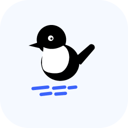
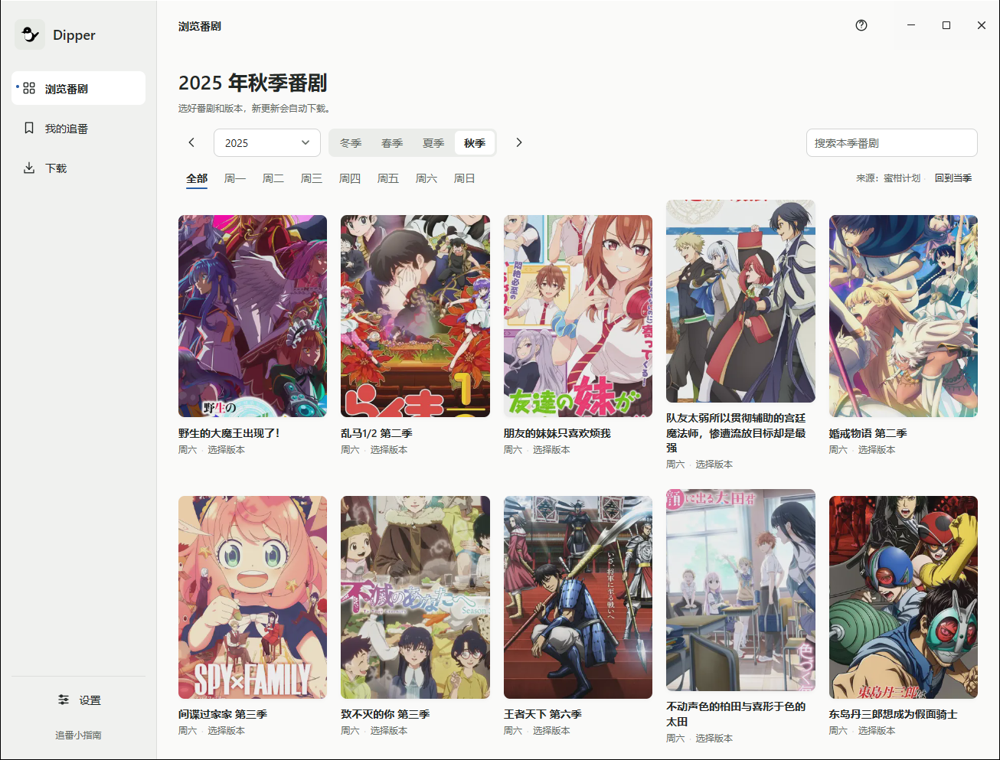
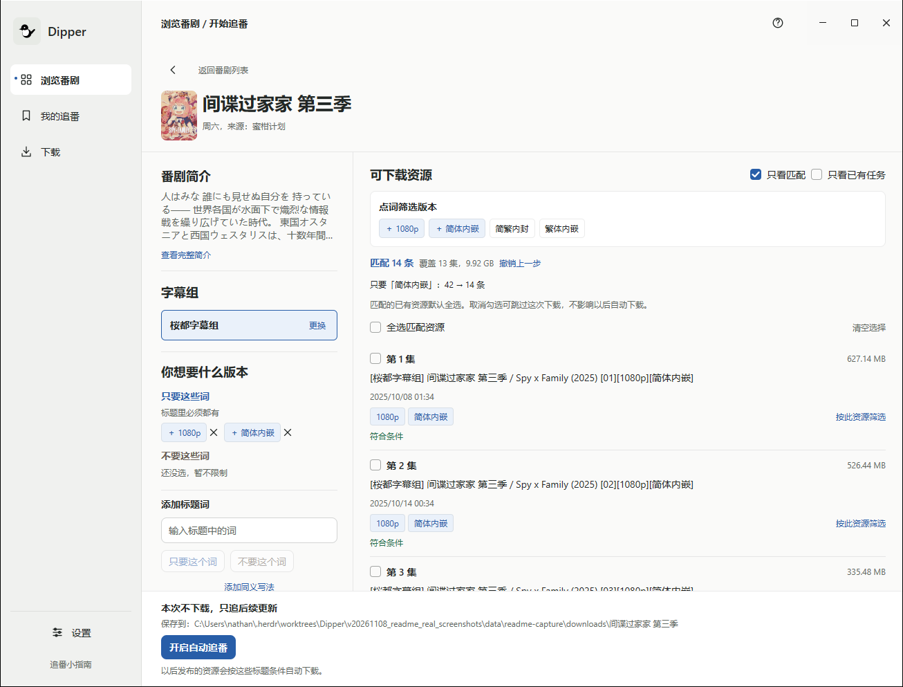
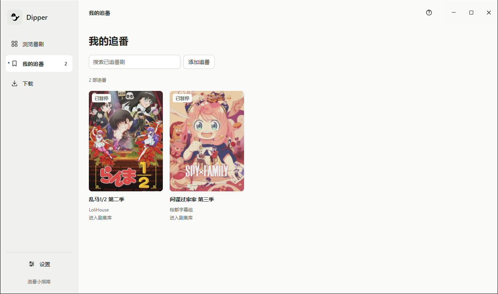

<div align="center">



# Dipper

**English** &nbsp;·&nbsp; [简体中文](README.zh-CN.md)

### Pick your anime. Leave the updates to Dipper.

Browse the season, choose the version you like, and bring new episodes home.<br>
A native desktop app with automatic following and a built-in downloader.

[](https://github.com/steampixel007/Dipper/actions/workflows/check.yml)
[](go.mod)
[](LICENSE)
[](https://github.com/egoist/mygo)

**[Download](https://github.com/steampixel007/Dipper/releases/latest)** &nbsp;·&nbsp; **[Get started](#get-started)** &nbsp;·&nbsp; **[User guide](docs/usage.md)** &nbsp;·&nbsp; **[Development](docs/development.md)** &nbsp;·&nbsp; **[Feedback](https://github.com/steampixel007/Dipper/issues)**

<br>

<a href="docs/assets/screenshots/01-browse.png">
  
</a>

<sub>Captured from Dipper running on Windows with the real Mikan autumn 2025 catalog. Screenshots taken on November 8, 2026.</sub>

</div>

## Get started

Download Dipper from this repository's **[Releases](https://github.com/steampixel007/Dipper/releases/latest)**.
Expand **Assets** and choose the file for your computer. You do not need Git or
Go. The filenames below are from `v0.1.3`, checked on November 8, 2026; later
releases use their own version number.

| Your computer | Download | Install and open |
| --- | --- | --- |
| Windows x64 (Intel or AMD) | `dipper_0.1.3_windows_amd64_setup.exe` | Open the installer, then launch Dipper from the Start menu. |
| Mac with Apple silicon (M series) | `dipper_0.1.3_darwin_arm64.dmg` | Open the disk image, drag Dipper to Applications, then open it there. |
| Mac with an Intel processor | `dipper_0.1.3_darwin_amd64.dmg` | Open the disk image, drag Dipper to Applications, then open it there. |
| Debian / Ubuntu Linux x64 | `dipper_0.1.3_linux_amd64.deb` | Install with your package manager, then open Dipper from the applications menu. [Install command and archive alternatives](docs/usage.md#install). |

On a Mac, **Apple menu → About This Mac** identifies the chip or processor
([Apple's guide](https://support.apple.com/en-us/116943)).
Choose an application download, rather than GitHub's **Source code** archives.

Windows packages have no publisher certificate. macOS packages use ad-hoc
signing without Apple notarization; the system may block the first launch.
See the [installation notes](docs/usage.md#install) if that happens.
Clean-machine installation and native macOS/Linux first launch have not been
validated in this documentation update.

In-app updates arrive with the next release: Settings gains a **软件更新**
(Software update) section, and Dipper will check for a stable release at most
once a day after startup. See [software updates](docs/usage.md#software-updates).

Once Dipper opens (the interface is currently in Chinese):

1. **Browse a series.** In **浏览番剧**, choose a season or weekday, or search
   the selected season by title.
2. **Choose a group and filter releases.** Open the series, choose a fansub
   group, then use title words such as `1080p` to include or exclude releases.
   Check the matching list before continuing.
3. **Download and follow it.** Keep the existing releases you want selected,
   then choose **下载并追番** (Download and follow). Dipper checks for matching
   updates while running.
4. **Watch an episode.** Open **我的追番**, click the series poster to enter its
   episode library, and choose **播放** beside a completed download. Playback
   opens your system's associated media player; install one if needed.

Files go to `Dipper` under your system's Videos folder by default. Change the
destination in Settings. See the [user guide](docs/usage.md) for file locations
and follow management.

## From finding a show to following it

Dipper keeps the whole journey in one window: the Mikan catalog, fansub
releases, version selection, and downloads to your computer. Start with a show;
there is no feed URL to paste or regular expression to write.

- **Find something to follow.** Browse by season and weekday, or search the
  current season by title.
- **Choose your version in plain words.** Pick a fansub group, then click words
  such as `1080p` or `HEVC` to include or exclude them. See matching releases
  while choosing what to download.
- **Let new episodes arrive.** While Dipper is running, it checks your follows
  every 15 minutes and downloads new matching releases. Check immediately
  whenever you like.
- **Keep control of your files.** Pause or resume downloads, retry a failure,
  open the destination folder, and stop sharing from the same app.

Built with Go and [MyGo Native UI](https://github.com/egoist/mygo). No browser,
Node.js, or separate download client is needed to run it. The interface is
currently in Chinese.

## Pick the release you actually want

Click a title word and choose **只要** (include), **不要** (exclude), or
**不限** (any). Matching counts and release selections update beside your
choices, and undo lets you try another combination.

<a href="docs/assets/screenshots/02-filter.png">
  
</a>

Existing matches are selected by default. Uncheck anything you do not want
this time; your future matching rule stays separate from that selection.
Later, you can fetch older releases without changing the rule.

## Follow along, without losing track

Open a poster in My Follows to see its episode library and play completed
downloads. Use the library's **···** menu to view resources or manage the follow.
Downloads are grouped by series and fansub group, each group with one progress
bar and the next action beside every task.

<a href="docs/assets/screenshots/03-following.png">
  
</a>

<sub>These saved follows were paused after capture setup. No episodes were downloaded for the screenshots.</sub>

On Windows and Linux, you can keep following and downloading in the tray when
you close the window. On macOS, closing the window keeps Dipper running in the
Dock. Quitting the app stops background activity.

## Development

To work on Dipper, build from source with the Go version pinned in [go.mod](go.mod).

**Windows · PowerShell**

```powershell
git clone https://github.com/steampixel007/Dipper.git
cd Dipper
powershell -ExecutionPolicy Bypass -File scripts/build.ps1 -Test
.\bin\dipper.exe
```

**macOS / Linux · Shell**

```sh
git clone https://github.com/steampixel007/Dipper.git
cd Dipper
sh scripts/build.sh --test
./bin/dipper
```

See the [development guide](docs/development.md) for graphics and tray runtime
dependencies, build options, and verification boundaries.

## A little bird, a rushing torrent

Dipper is named after the white-throated dipper (河乌), a small songbird that
dives into rushing mountain streams and returns with what it came for.
Here, the torrents bring back anime.

## License

Dipper is released under the [MIT License](LICENSE). You may use, modify, and
redistribute it, including commercially, as long as the copyright and license
notice are included with the software.

Third-party components keep their own licenses; see the
[third-party notices](THIRD-PARTY.md). The MIT License does not grant trademark
rights in the Dipper name or logo. Some sample data and artwork come from Mikan
and are not covered by the MIT License.

Contributions are accepted under the MIT License with a Developer Certificate
of Origin sign-off; see [CONTRIBUTING.md](CONTRIBUTING.md).

## More about Dipper

| | |
| :-- | :-- |
| [User guide](docs/usage.md) | Following, downloads, background behavior, and where your files live |
| [Development](docs/development.md) | Build scripts, diagnostic flags, icons, and verification boundaries |
| [Design system](DESIGN.md) | The bird, colors, controls, and interaction principles |
| [Architecture](docs/architecture.md) | How the native app, source, core, and downloader fit together |
| [Subsystems](docs/subsystems/README.md) | Implementation contracts and what their tests prove |
| [License](LICENSE) | MIT license for Dipper's original code and documentation |
| [Third-party notices](THIRD-PARTY.md) | Licenses of bundled Go modules and sample artwork |
| [Contributing](CONTRIBUTING.md) | How to submit a change and sign off |
| [Report an issue](https://github.com/steampixel007/Dipper/issues) | Bugs, questions, and feature ideas |
