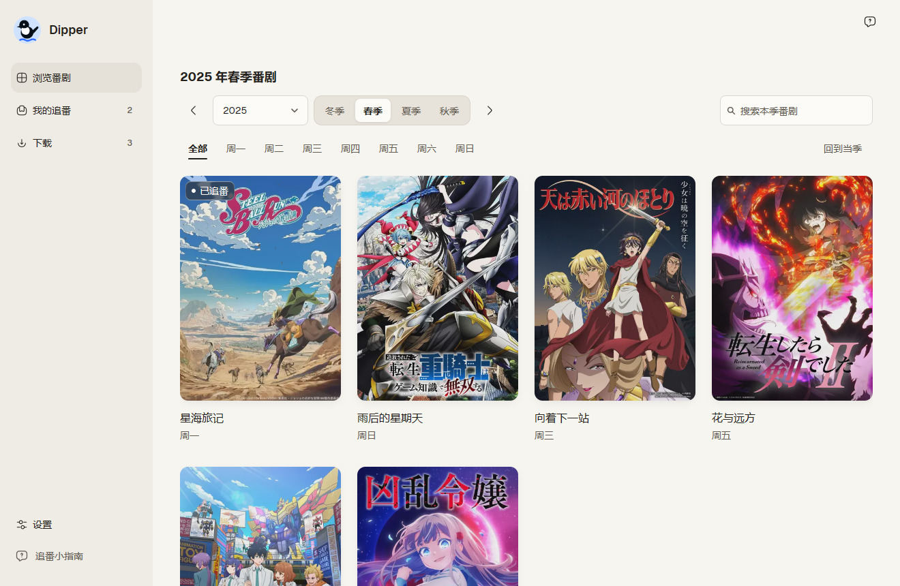
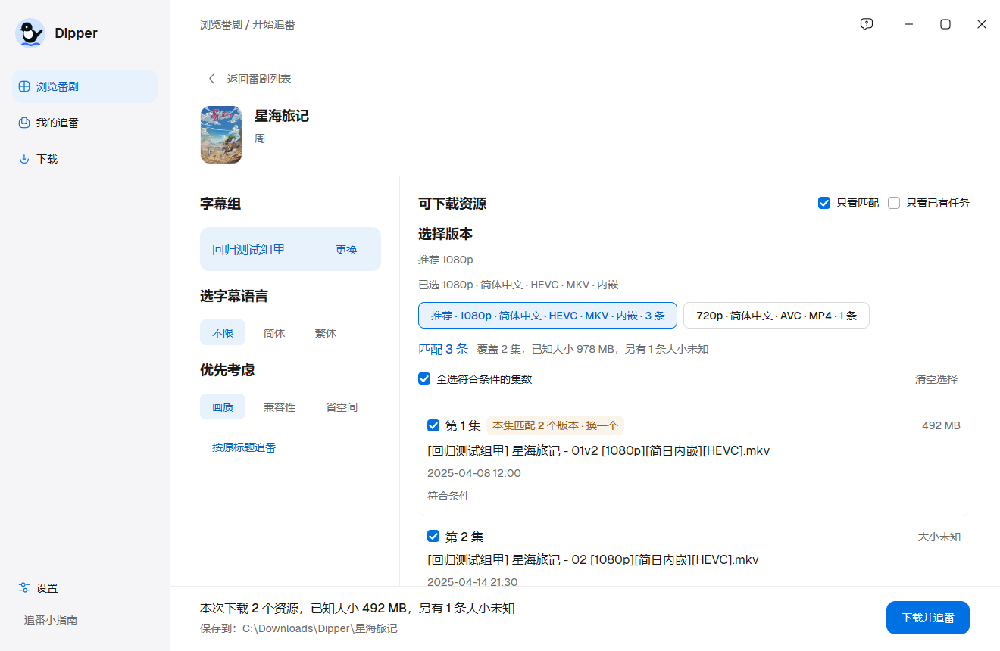
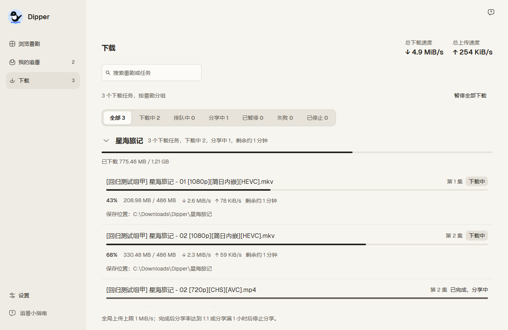
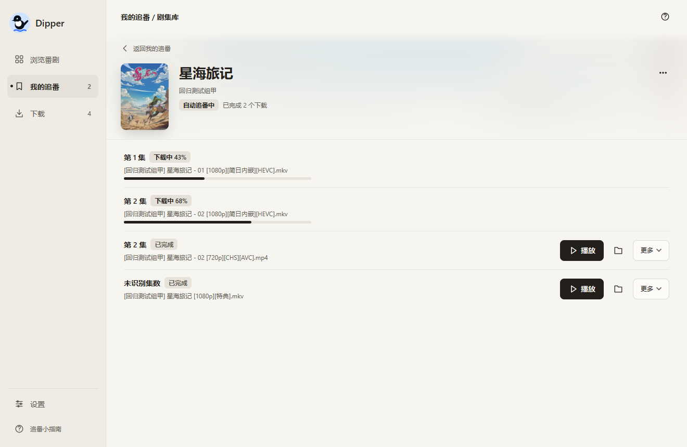

# Dipper

**安静、克制的原生桌面追番工具——浏览蜜柑目录、选好版本，新集自动下载到本地。**

[English](README.md) &nbsp;·&nbsp; **简体中文**

  
  
  
  
  

**[下载最新版](https://github.com/steampixel007/Dipper/releases/latest)** &nbsp;·&nbsp; [核心特性](#核心特性) &nbsp;·&nbsp; [使用流程](#使用流程) &nbsp;·&nbsp; [使用指南（英文）](docs/usage.md) &nbsp;·&nbsp; [问题反馈](https://github.com/steampixel007/Dipper/issues)

 

<picture>
  <source media="(prefers-color-scheme: dark)" srcset="docs/assets/ui/01-browse-dark.png">
  <source media="(prefers-color-scheme: light)" srcset="docs/assets/ui/01-browse.png">
  
</picture>

自动适配 GitHub 浅色 / 深色模式的界面预览（基于内置示例目录渲染）。

---

## 核心特性

- **单一原生可执行文件** — 使用 Go 与 [MyGo Native UI](https://github.com/egoist/mygo) 构建，不依赖浏览器内核、Node.js 或第三方 BT 客户端，开箱即用。
- **按偏好自动推荐版本** — 选择字幕语言（不限 / 简体 / 繁体）与优先考虑（画质 / 兼容性 / 省空间），自动匹配并推荐合适版本；每集默认只选一份并优先 `01v2` 等修订版，支持单集换版本，也提供「按原标题追番」关键词兜底规则。
- **内置 BitTorrent 下载引擎** — 运行时每 15 分钟检查新集并带退避重试；支持下载并发数控制、全局上传限速、自定义做种时长与分享率、带认证的自定义代理，以及内置 Tracker 管理（支持导入在线清单与恢复 XIU2 内置清单）。
- **整洁剧集库与托盘常驻** — 自动按 `番剧/字幕组/` 归档文件，下载完成后一键调用系统播放器播放；取消追番后仍保留下载记录；支持 Windows / Linux 系统托盘与 macOS Dock 后台运行。
- **校验式应用内更新** — 支持每日自动检查或手动检查 GitHub 稳定版，安装前自动对照 `SHA256SUMS` 校验完整性，点击重启即可平滑更新。
- **极简浅色 / 深色界面** — 提供浅色、夜间与跟随系统三种外观，支持减少动态效果与完整键盘导航。

## 使用流程

### 1. 选好字幕组与观看偏好

在「浏览番剧」按季度、星期或番名找到想追的番。进入详情页后默认选中资源最多的字幕组，按你的字幕语言和画质偏好自动推荐版本；预览匹配剧集无误后点击 **下载并追番** 即可。

<picture>
  <source media="(prefers-color-scheme: dark)" srcset="docs/assets/ui/02-filter-dark.png">
  <source media="(prefers-color-scheme: light)" srcset="docs/assets/ui/02-filter.png">
  
</picture>

### 2. 自动追更，下载全程可控

Dipper 运行期间会自动检查新发布并排队下载。在「下载」页按番剧查看实时进度、上下行速度与分享状态，或前往「设置」调整下载并发上限、上传限速、分享策略、代理和 Tracker。

<picture>
  <source media="(prefers-color-scheme: dark)" srcset="docs/assets/ui/04-downloads-dark.png">
  <source media="(prefers-color-scheme: light)" srcset="docs/assets/ui/04-downloads.png">
  
</picture>

### 3. 在剧集库一键播放

在「我的追番」点击海报进入剧集库，查看已下载与进行中的剧集。点击 **播放** 直接用系统默认播放器打开，也可以在右上角 **···** 菜单中补下旧集、修改追番条件、暂停追番或打开番剧文件夹。

<picture>
  <source media="(prefers-color-scheme: dark)" srcset="docs/assets/ui/13-episode-library-dark.png">
  <source media="(prefers-color-scheme: light)" srcset="docs/assets/ui/13-episode-library.png">
  
</picture>

## 下载安装

前往 [Releases 最新版本](https://github.com/steampixel007/Dipper/releases/latest)，展开 **Assets**，选择对应平台的安装包：

| 平台 | 推荐安装包 | 免安装 / 压缩包 | 启动方式 |
| --- | --- | --- | --- |
| Windows x64（Intel / AMD） | `*_windows_amd64_setup.exe` | `*_windows_amd64.zip` | 运行安装程序后从开始菜单打开，或解压 ZIP 直接运行 `Dipper.exe`。 |
| macOS（Apple 芯片） | `*_darwin_arm64.dmg` | `*_darwin_arm64.tar.gz` | 打开 DMG（或解压压缩包），将 `Dipper.app` 拖入「应用程序」后打开。 |
| macOS（Intel 芯片） | `*_darwin_amd64.dmg` | `*_darwin_amd64.tar.gz` | 打开 DMG（或解压压缩包），将 `Dipper.app` 拖入「应用程序」后打开。 |
| Debian / Ubuntu x64 | `*_linux_amd64.deb` | `*_linux_amd64.tar.gz` | 运行 `sudo apt install ./dipper_*_linux_amd64.deb`，再从应用菜单启动。 |

> [!NOTE]
> 每个发行版均附带 `SHA256SUMS` 校验文件。关于首次启动系统安全提示、Linux 压缩包运行依赖、数据目录位置及应用内更新机制，请参阅[使用指南（英文）](docs/usage.md)。

## 从源码构建

Dipper 使用纯 Go（发布构建采用 `CGO_ENABLED=0`）与 [MyGo Native UI](https://github.com/egoist/mygo)。克隆仓库后，使用 [go.mod](go.mod) 中指定的 Go 版本在仓库根目录运行：

| 平台 | 构建并测试 | 启动 |
| --- | --- | --- |
| Windows（PowerShell） | `powershell -ExecutionPolicy Bypass -File scripts/build.ps1 -Test` | `.\bin\dipper.exe` |
| macOS / Linux | `sh scripts/build.sh --test` | `./bin/dipper` |

### 相关文档

| 文档 | 内容 |
| --- | --- |
| [使用指南](docs/usage.md) | 安装方式、应用内更新、追番与传输策略、本地文件路径（英文） |
| [开发指南](docs/development.md) | 本地开发、诊断参数、界面预览渲染与验证流程（英文） |
| [项目架构](docs/architecture.md) | 整体结构与包边界说明（英文） |
| [子系统文档](docs/subsystems/README.md) | `core`、`downloader`、`source`、`instance`、`update`、`gui` 的不变量与测试覆盖（英文） |
| [设计系统](DESIGN.md) | 色彩、排版、动效与交互规范（英文） |
| [贡献指南](CONTRIBUTING.md) | 提交规范与 Developer Certificate of Origin（DCO）签署说明（英文） |

## 名字的来历

Dipper 的名字来自河乌（white-throated dipper）——一种会潜入湍急山溪觅食的小型鸣禽。在这里，torrent 激流带回的是你想看的番。

## 开源许可

Dipper 的原创代码和文档采用 [MIT 许可证](LICENSE)。再分发时需保留版权和许可证声明。许可证不授予 Dipper 名称或标志的商标权。

第三方组件及蜜柑示例数据声明见 [THIRD-PARTY.md](THIRD-PARTY.md)。提交贡献需签署 Developer Certificate of Origin（DCO），详见[贡献指南（英文）](CONTRIBUTING.md)。
