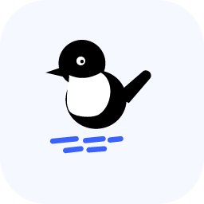
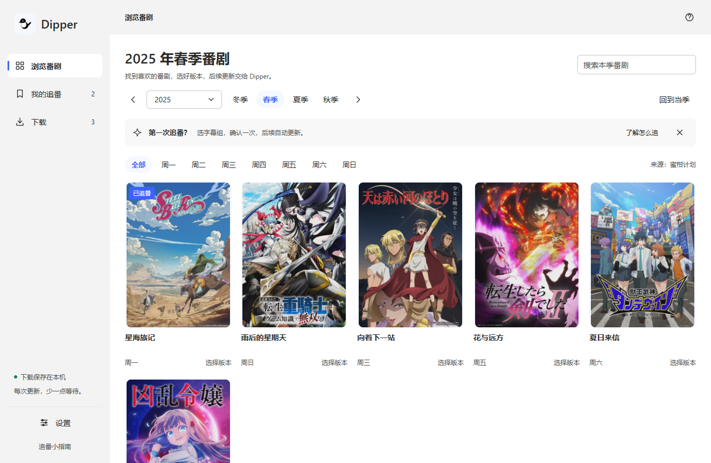
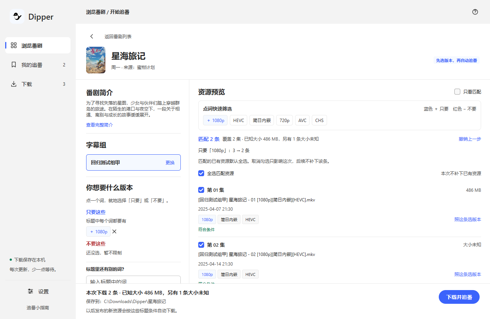
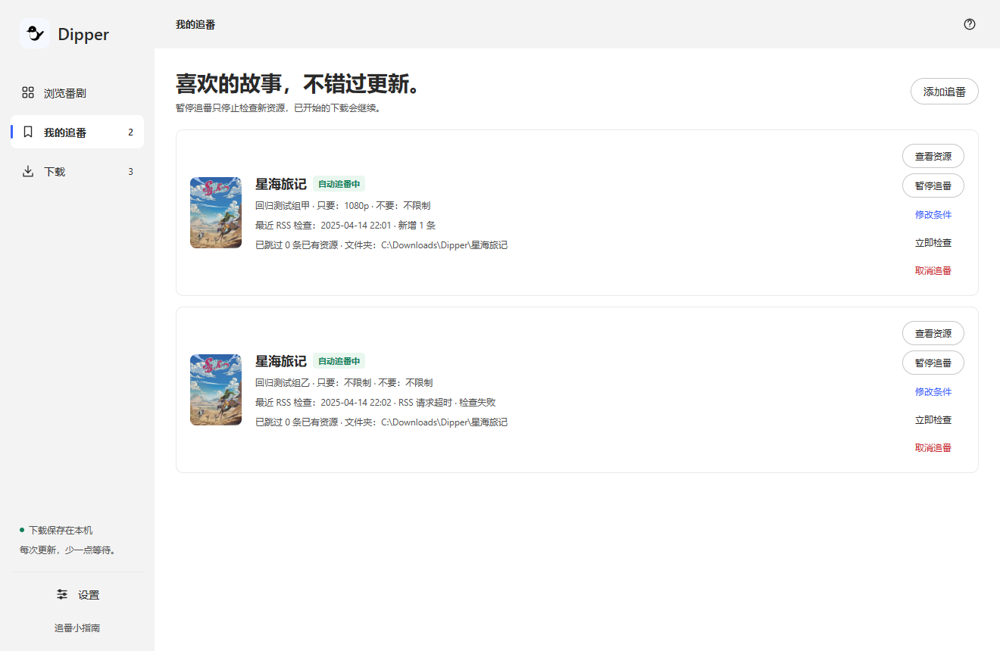
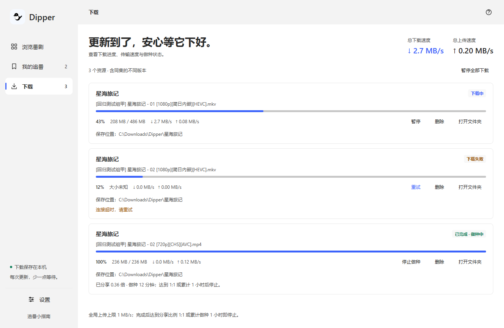

<div align="center">



# Dipper

[English](README.md) &nbsp;·&nbsp; **简体中文**

### 挑好想看的番，更新交给 Dipper。

浏览当季新番，选好喜欢的版本，让新一集自动下载到电脑。<br>
原生桌面应用，支持自动追番，内置下载器。

[](https://github.com/steampixel007/Dipper/actions/workflows/check.yml)
[](go.mod)
[](https://github.com/egoist/mygo)

**[开始使用](#开始使用)** &nbsp;·&nbsp; **[使用指南（英文）](docs/usage.md)** &nbsp;·&nbsp; **[开发指南（英文）](docs/development.md)** &nbsp;·&nbsp; **[问题反馈](https://github.com/steampixel007/Dipper/issues)**

<br>

<a href="docs/assets/ui/01-browse.png">
  
</a>

<sub>截图为使用示例数据渲染的原生界面，番名、字幕组和传输数据仅作展示。</sub>

</div>

## 从发现新番到自动追更

Dipper 把蜜柑目录、字幕组发布记录、版本选择和本地下载放在同一个窗口里。从选一部番开始，无需粘贴订阅地址，也不用编写正则表达式。

- **找到想追的番。** 按季度、星期浏览，或在当前季度内搜索番名。
- **用看得懂的词选版本。** 先选字幕组，再点击 `1080p`、`HEVC` 等标题词，选择包含或排除；确认前就能看到匹配的发布记录。
- **让新一集自动到来。** Dipper 运行期间，每 15 分钟检查一次追番，自动下载符合条件的新发布；也可以随时手动检查。
- **下载由你掌控。** 暂停、继续、失败重试、打开下载文件夹和停止做种，都能在应用中完成。

使用 Go 和 [MyGo Native UI](https://github.com/egoist/mygo) 构建。运行时无需浏览器、Node.js 或额外的下载客户端。当前界面为中文。

## 选中真正想要的版本

点击标题里的词，选择 **只要**、**不要** 或 **不限**。匹配数量与发布记录会随之更新，也可以撤销操作，试试其他组合。

<a href="docs/assets/ui/02-filter.png">
  
</a>

已有的匹配记录默认勾选。不想这次下载的内容，取消勾选即可；这次的下载选择与今后的匹配规则相互独立。之后也可以补下旧集，无需改动规则。

## 追番与下载，进展一目了然

追番列表会显示检查结果和需要处理的问题。下载列表会显示进度、传输速度，并在每个任务旁提供下一步操作。

<table>
  <tr>
    <th width="50%">我的追番</th>
    <th width="50%">我的下载</th>
  </tr>
  <tr>
    <td><a href="docs/assets/ui/03-following.png"></a></td>
    <td><a href="docs/assets/ui/04-downloads.png"></a></td>
  </tr>
</table>

在 Windows 和 Linux 上，关闭窗口后可以让 Dipper 留在托盘，继续追番和下载。在 macOS 上，关闭窗口后 Dipper 会继续在 Dock 中运行。退出应用会停止后台活动。

## 开始使用

使用 [go.mod](go.mod) 指定的 Go 版本，从源码构建。

**Windows · PowerShell**

```powershell
git clone https://github.com/steampixel007/Dipper.git
cd Dipper
powershell -ExecutionPolicy Bypass -File scripts/build.ps1 -Test
.\bin\dipper.exe
```

**macOS / Linux · Shell**

```sh
git clone https://github.com/steampixel007/Dipper.git
cd Dipper
sh scripts/build.sh --test
./bin/dipper
```

Windows 构建未签名，可能触发 SmartScreen 提示。macOS 和 Linux 需要原生图形及托盘运行依赖，这两个平台的原生桌面验收尚未完成。构建选项与验证范围见[开发指南（英文）](docs/development.md)。

打开后，按顺序操作：**选番 → 选字幕组 → 选版本 → 确认下载并追番。** 文件默认保存到系统“视频”文件夹下的 `Dipper` 目录，可在设置中修改下载位置。

## 一只小鸟，一道湍流

Dipper 得名于河乌（white-throated dipper）：一种会潜入湍急山溪、带回食物的小型鸣禽。在这里，torrent 带回的是你想看的番。

## 进一步了解 Dipper

| 文档与入口 | 内容 |
| :-- | :-- |
| [使用指南（英文）](docs/usage.md) | 追番、下载、后台运行与文件存放位置 |
| [开发指南（英文）](docs/development.md) | 构建脚本、诊断参数、图标与验证范围 |
| [设计系统（英文）](DESIGN.md) | 河乌、配色、控件与交互原则 |
| [架构说明（英文）](docs/architecture.md) | 原生应用、数据源、核心逻辑和下载器如何协作 |
| [子系统文档（英文）](docs/subsystems/README.md) | 实现约定与各项测试的验证范围 |
| [问题反馈](https://github.com/steampixel007/Dipper/issues) | 缺陷、疑问与功能建议 |
