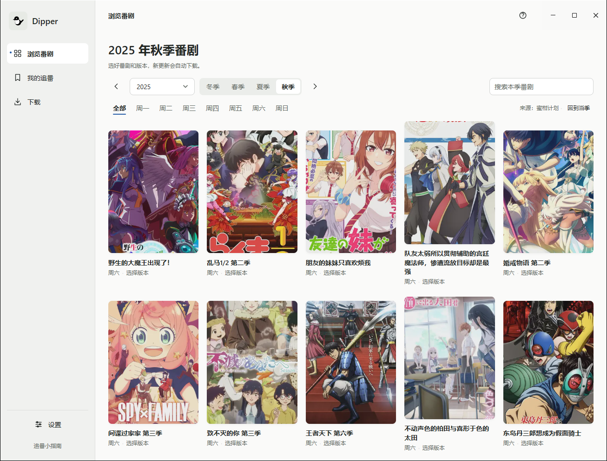
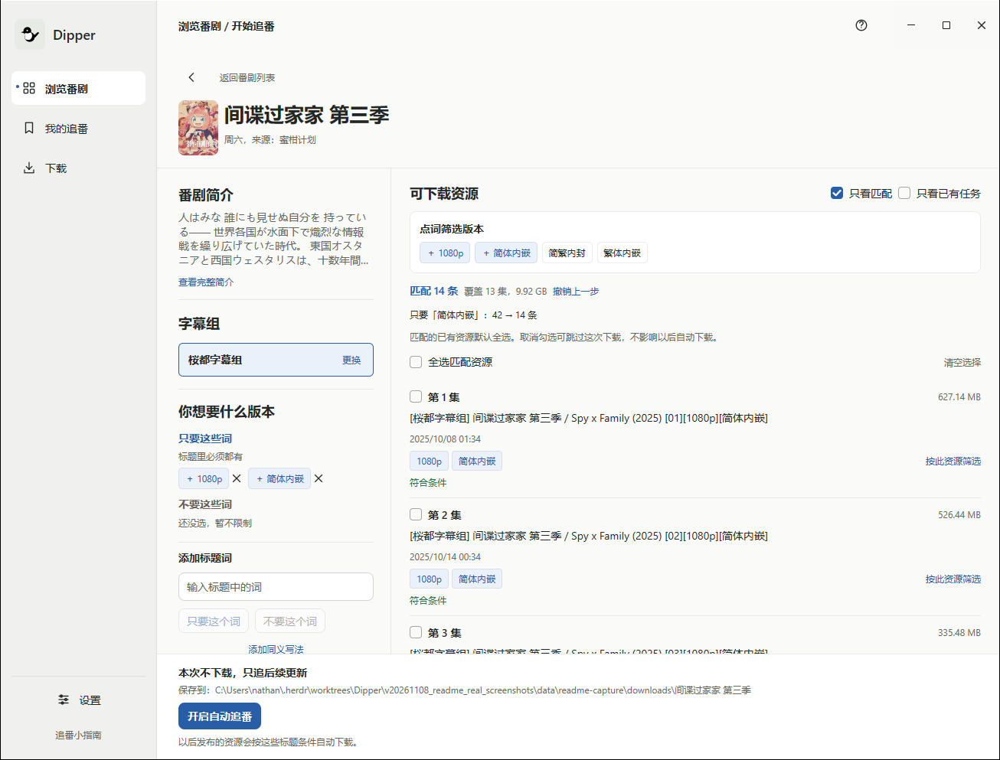
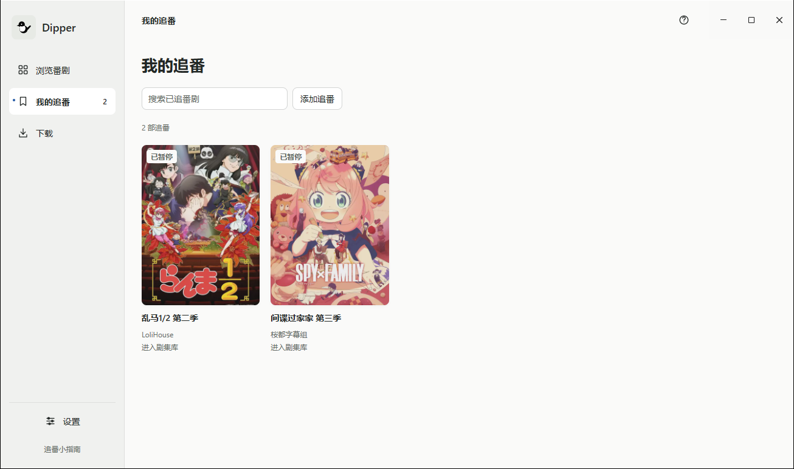

# Dipper

[English](README.md) &nbsp;·&nbsp; **简体中文**

Dipper 是一款桌面追番工具。在蜜柑目录里找番，选好字幕组和版本，Dipper 运行时就会用内置下载器把符合条件的新资源下载到电脑。

**[下载 Dipper](https://github.com/steampixel007/Dipper/releases/latest)** &nbsp;·&nbsp; [开始使用](#开始使用) &nbsp;·&nbsp; [使用指南（英文）](docs/usage.md) &nbsp;·&nbsp; [问题反馈](https://github.com/steampixel007/Dipper/issues)

Windows 实机截图，展示蜜柑 2025 年秋季番剧目录。

## 开始使用

打开[下载页](https://github.com/steampixel007/Dipper/releases/latest)，展开 **Assets**，按文件名后缀选适合你电脑的安装包。

| 你的电脑 | 文件名后缀 | 怎么打开 |
| --- | --- | --- |
| Windows x64（Intel 或 AMD） | `_windows_amd64_setup.exe` | 运行安装程序，再从开始菜单打开 Dipper。 |
| Apple 芯片 Mac | `_darwin_arm64.tar.gz` | 解压后把 Dipper 拖进「应用程序」，再从那里打开。 |
| Intel 芯片 Mac | `_darwin_amd64.dmg` | 打开 DMG，把 Dipper 拖进「应用程序」，再从那里打开。 |
| Debian 或 Ubuntu x64 | `_linux_amd64.deb` | 安装软件包，再从应用菜单打开 Dipper。 |

Dipper 使用中文界面。Mac 用户可以在「苹果菜单 → 关于本机」查看芯片。免安装版和首次启动提示见[安装指南（英文）](docs/usage.md#install)，应用内更新见[软件更新（英文）](docs/usage.md#software-updates)。

## 追一部番

1. 打开「浏览番剧」，按季度或星期找番，也可以搜索当前季度的番名。
2. 选一个字幕组，再点发布标题里的词，比如 `1080p`，选择「只要」「不要」或「不限」。列表会随筛选条件更新。
3. 勾好这次想下载的资源，点击「下载并追番」。取消勾选会跳过对应资源的本次下载，今后的筛选条件照样保留。

Dipper 运行时每 15 分钟检查一次新资源，符合条件就自动下载。你也可以手动检查，或之后再补下旧集。

## 看已经下载的剧集

打开「我的追番」，点番剧海报进入剧集库。对下载完成的资源点「播放」，Dipper 会用系统关联的播放器打开。下载默认保存在系统「视频」文件夹下的 `Dipper` 目录，可以在设置里更改。

在 Windows 和 Linux 上，关闭窗口后可以让 Dipper 留在托盘继续运行。在 macOS 上，关闭窗口后应用仍在 Dock 中运行。退出 Dipper 会停止检查和下载。[管理追番与下载（英文）](docs/usage.md#manage-follows-and-downloads)

## 开发

Dipper 用 Go 和 [MyGo Native UI](https://github.com/egoist/mygo) 构建。克隆仓库后，使用 [go.mod](go.mod) 指定的 Go 版本，在仓库根目录运行以下命令。

| 平台 | 构建并测试 | 启动 |
| --- | --- | --- |
| Windows（PowerShell） | `powershell -ExecutionPolicy Bypass -File scripts/build.ps1 -Test` | `.\bin\dipper.exe` |
| macOS 或 Linux | `sh scripts/build.sh --test` | `./bin/dipper` |

[开发指南](docs/development.md) · [架构](docs/architecture.md) · [子系统](docs/subsystems/README.md) · [设计](DESIGN.md) · [贡献指南](CONTRIBUTING.md) · [构建检查](https://github.com/steampixel007/Dipper/actions/workflows/check.yml)

## 名字的来历

Dipper 的名字来自河乌（white-throated dipper），一种会潜入湍急山溪觅食的小型鸣禽。在这里，torrent 带回的是你想看的番。

## 开源许可

Dipper 的原创代码和文档采用 [MIT 许可证](LICENSE)。再分发时需保留版权和许可证声明。许可证不授予 Dipper 名称或标志的商标权。第三方组件、蜜柑示例数据和封面图另见[第三方声明](THIRD-PARTY.md)。

提交贡献时需签署 Developer Certificate of Origin（DCO）。详见[贡献指南（英文）](CONTRIBUTING.md)。
