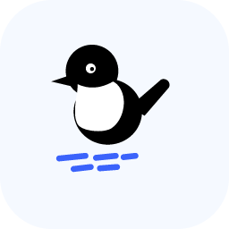
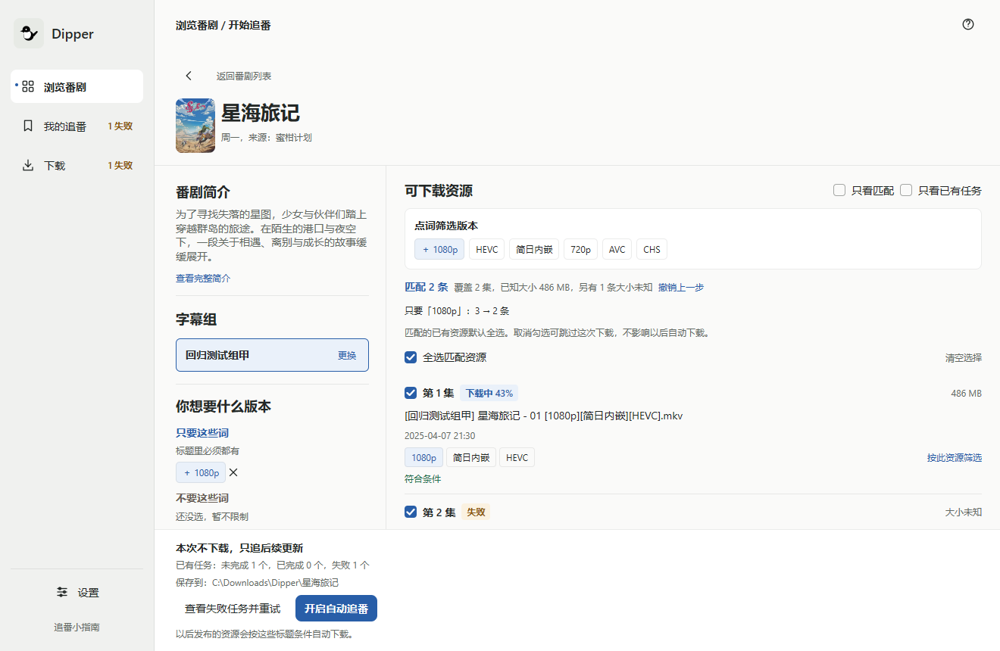
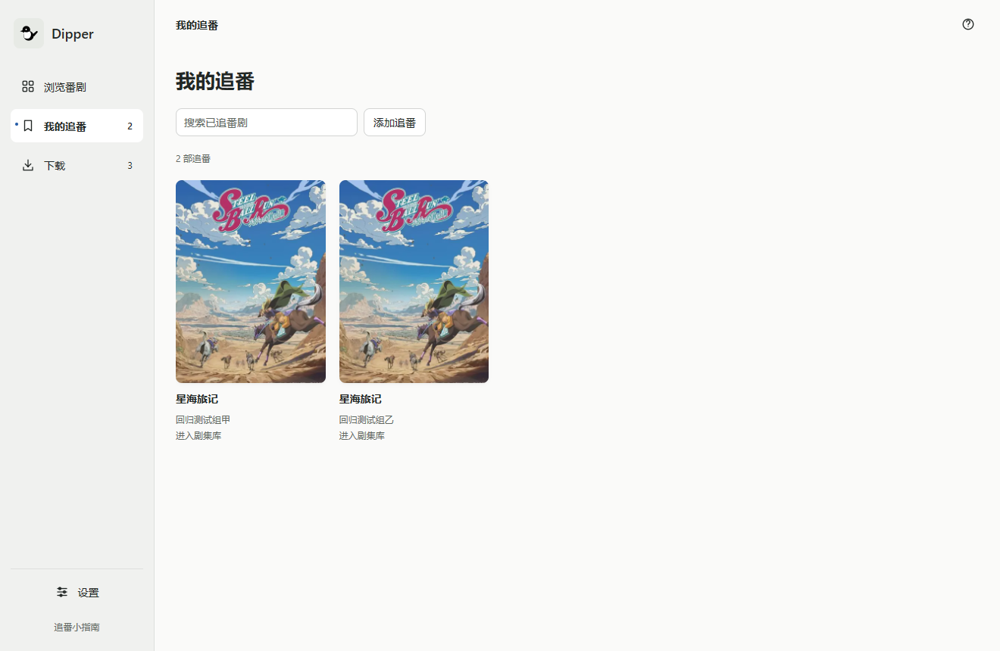
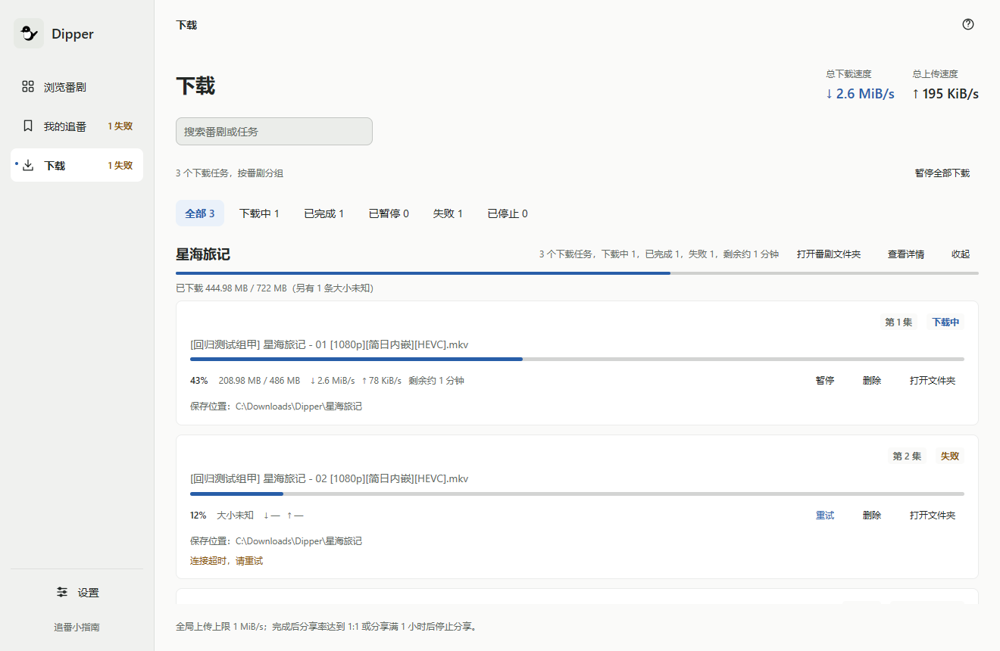

<div align="center">



# Dipper

[English](README.md) &nbsp;·&nbsp; **简体中文**

### 挑好想看的番，更新交给 Dipper。

浏览当季新番，选好喜欢的版本，让新一集自动下载到电脑。<br>
原生桌面应用，支持自动追番，内置下载器。

[](https://github.com/steampixel007/Dipper/actions/workflows/check.yml)
[](go.mod)
[](LICENSE)
[](https://github.com/egoist/mygo)

**[下载 Dipper](https://github.com/steampixel007/Dipper/releases/latest)** &nbsp;·&nbsp; **[开始使用](#开始使用)** &nbsp;·&nbsp; **[使用指南（英文）](docs/usage.md)** &nbsp;·&nbsp; **[开发指南（英文）](docs/development.md)** &nbsp;·&nbsp; **[问题反馈](https://github.com/steampixel007/Dipper/issues)**

<br>

<a href="docs/assets/ui/01-browse.png">
  
</a>

<sub>截图为使用示例数据渲染的原生界面，番名、字幕组和传输数据仅作展示。</sub>

</div>

## 开始使用

前往本仓库的 **[Releases 下载页](https://github.com/steampixel007/Dipper/releases/latest)**，展开 **Assets**，选择适合电脑的安装包，无需安装 Git 或 Go。下表列出的是 2026 年 11 月 6 日核实的 `v0.1.2` 文件名；后续版本的文件名会使用对应的版本号。

| 你的电脑 | 下载文件 | 安装与打开 |
| --- | --- | --- |
| Windows x64（Intel 或 AMD） | `dipper_0.1.2_windows_amd64_setup.exe` | 打开安装程序，完成后从开始菜单启动 Dipper。 |
| Apple 芯片 Mac（M 系列） | `dipper_0.1.2_darwin_arm64.dmg` | 打开磁盘映像，把 Dipper 拖入“应用程序”，再从那里打开。 |
| Intel 芯片 Mac | `dipper_0.1.2_darwin_amd64.dmg` | 打开磁盘映像，把 Dipper 拖入“应用程序”，再从那里打开。 |
| Debian / Ubuntu Linux x64 | `dipper_0.1.2_linux_amd64.deb` | 使用系统的软件包管理器安装，再从应用菜单打开。[安装命令与压缩包用法（英文）](docs/usage.md#install)。 |

Mac 用户可以在 **苹果菜单 → 关于本机** 中查看芯片或处理器，参见 [Apple 说明](https://support.apple.com/zh-cn/116943)。请选择上表中的应用安装包；下载页的 **Source code** 是源码包。

Windows 安装包没有发布者证书；macOS 安装包使用临时签名，未经 Apple 公证，首次打开时可能被系统拦截。处理方式见[安装说明（英文）](docs/usage.md#install)。本次文档更新未验证全新系统安装，也未完成 macOS / Linux 原生环境的首次启动验收。

打开 Dipper 后：

1. **找到想看的番。** 在“浏览番剧”中按季度、星期浏览，或搜索当前季度的番名。
2. **选字幕组，筛选资源。** 打开番剧，选好字幕组，再点击 `1080p` 等标题词，选择“只要”或“不要”，查看哪些资源符合条件。
3. **下载并追番。** 保留这次想下载的资源勾选，点击“下载并追番”。Dipper 运行期间会自动检查符合条件的新资源。
4. **进剧集库观看。** 打开“我的追番”，点击番剧海报进入剧集库，找到已下载完成的资源，点击“播放”。视频会交给系统关联的播放器打开；尚未安装播放器时，需要先安装。

文件默认保存到系统“视频”文件夹下的 `Dipper` 目录，可在设置中修改下载位置。文件位置与追番管理详见[使用指南（英文）](docs/usage.md)。

## 从发现新番到自动追更

Dipper 把蜜柑目录、字幕组发布记录、版本选择和本地下载放在同一个窗口里。从选一部番开始，无需粘贴订阅地址，也不用编写正则表达式。

- **找到想追的番。** 按季度、星期浏览，或在当前季度内搜索番名。
- **用看得懂的词选版本。** 先选字幕组，再点击 `1080p`、`HEVC` 等标题词，选择包含或排除；勾选时就能看到匹配的发布记录。
- **让新一集自动到来。** Dipper 运行期间，每 15 分钟检查一次追番，自动下载符合条件的新发布；也可以随时手动检查。
- **下载由你掌控。** 暂停、继续、失败重试、打开下载文件夹和停止分享，都能在应用中完成。

使用 Go 和 [MyGo Native UI](https://github.com/egoist/mygo) 构建。运行时无需浏览器、Node.js 或额外的下载客户端。当前界面为中文。

## 选中真正想要的版本

点击标题里的词，选择 **只要**、**不要** 或 **不限**。匹配数量与发布记录会随之更新，也可以撤销操作，试试其他组合。

<a href="docs/assets/ui/02-filter.png">
  
</a>

已有的匹配记录默认勾选。不想这次下载的内容，取消勾选即可；这次的下载选择与今后的匹配规则相互独立。之后也可以补下旧集，无需改动规则。

## 追番与下载，进展一目了然

在“我的追番”中点击海报，就能进入剧集库，播放已下载完成的资源。查看资源、修改条件等管理操作放在剧集库的 **···** 菜单中。下载列表会显示进度、传输速度，并在每个任务旁提供下一步操作。

<table>
  <tr>
    <th width="50%">我的追番</th>
    <th width="50%">我的下载</th>
  </tr>
  <tr>
    <td><a href="docs/assets/ui/03-following.png"></a></td>
    <td><a href="docs/assets/ui/04-downloads.png"></a></td>
  </tr>
</table>

在 Windows 和 Linux 上，关闭窗口后可以让 Dipper 留在托盘，继续追番和下载。在 macOS 上，关闭窗口后 Dipper 会继续在 Dock 中运行。退出应用会停止后台活动。

## 开发

参与开发时，使用 [go.mod](go.mod) 指定的 Go 版本从源码构建。

**Windows · PowerShell**

```powershell
git clone https://github.com/steampixel007/Dipper.git
cd Dipper
powershell -ExecutionPolicy Bypass -File scripts/build.ps1 -Test
.\bin\dipper.exe
```

**macOS / Linux · Shell**

```sh
git clone https://github.com/steampixel007/Dipper.git
cd Dipper
sh scripts/build.sh --test
./bin/dipper
```

原生图形及托盘运行依赖、构建选项与验证范围见[开发指南（英文）](docs/development.md)。

## 一只小鸟，一道湍流

Dipper 得名于河乌（white-throated dipper）：一种会潜入湍急山溪、带回食物的小型鸣禽。在这里，torrent 带回的是你想看的番。

## 开源许可

Dipper 以 [MIT 许可证](LICENSE) 开源。你可以使用、修改和再分发，包括商业使用，只需随软件保留版权声明和许可证声明。

第三方组件仍适用各自的许可证；见[第三方声明](THIRD-PARTY.md)。MIT 许可证不授予 “Dipper” 名称或标志的商标权。部分示例数据与封面图来自 Mikan，不在 MIT 许可范围内。

贡献将以 MIT 许可证接受，并需在每次提交中签署 Developer Certificate of Origin；见[贡献指南（英文）](CONTRIBUTING.md)。

## 进一步了解 Dipper

| 文档与入口 | 内容 |
| :-- | :-- |
| [使用指南（英文）](docs/usage.md) | 追番、下载、后台运行与文件存放位置 |
| [开发指南（英文）](docs/development.md) | 构建脚本、诊断参数、图标与验证范围 |
| [设计系统（英文）](DESIGN.md) | 河乌、配色、控件与交互原则 |
| [架构说明（英文）](docs/architecture.md) | 原生应用、数据源、核心逻辑和下载器如何协作 |
| [子系统文档（英文）](docs/subsystems/README.md) | 实现约定与各项测试的验证范围 |
| [开源许可](LICENSE) | Dipper 原创代码与文档的 MIT 许可证 |
| [第三方声明](THIRD-PARTY.md) | 内置 Go 模块与示例图片的许可证 |
| [贡献指南（英文）](CONTRIBUTING.md) | 如何提交改动与签署 DCO |
| [问题反馈](https://github.com/steampixel007/Dipper/issues) | 缺陷、疑问与功能建议 |
