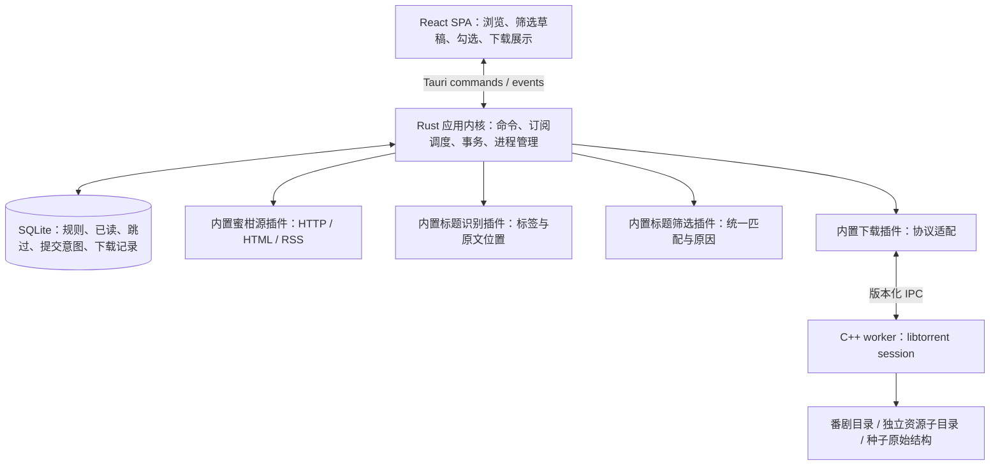

# Dipper V1 技术调研与选型

- 调研日期：2026-10-20。
- 需求依据：[PRD-v1.md](<PRD-v1.md>)。
- 文档状态：历史候选调研与来源证据；当前实施方案以 [TECH-STACK-v1.md](<TECH-STACK-v1.md>) 为准。
- 项目现状：调研开始时只有 PRD，没有既有代码和技术栈；尚未初始化应用。
- 调研方法：阅读官方文档、库 API 文档及蜜柑公开页面/RSS；区分“实际读到的数据”“官方宣称的能力”和“仍需运行验证的行为”。本轮未安装依赖、编写业务代码、运行下载或完成性能基准。

## 1. 当前结论与历史调研范围

用户已确定 **MyGo Native UI + Go**。主界面采用 Go 原生 ui 包；应用业务使用 Go，测试以 MyGo Tester、Go 集成测试与三端桌面专项为基础。

完整的当前推荐、剩余依赖和验证门槛见 [TECH-STACK-v1.md](<TECH-STACK-v1.md>)。BT 首选候选为 anacrolix/torrent，持久化推荐 SQLite + database/sql + modernc.org/sqlite；这些依赖仍须固定版本并通过原型验证，不能视作已经实现。

**本文第 2–14 节保留前期调研材料。**其中 Tauri、Electron、Wails、React/Vue、Rust/SQLx、C++ 下载进程及各方案推荐顺位均属于历史候选分析，不再作为 Dipper 的当前主方案。蜜柑字段/接口实证、去重/持久化要求、BT 能力比较和未决事项仍可参考；语言和接口实现以当前选型文档为准。

未进行包体、内存、下载恢复或三端性能实测，不将框架宣传数字作为本项目结果。

## 2. 从 PRD 提取的决策约束

| 约束 | 对技术方案的直接影响 |
| --- | --- |
| 三端安装后无需外部下载器 | BT 必须随应用分发；仅支持浏览器 WebRTC 的方案不足以覆盖普通 BT 资源 |
| 隐藏窗口后继续工作 | RSS、下载和做种控制不能放在前端计时器中；完全退出须结束所有子进程 |
| 1:1 或有效做种 1 小时，先到即停 | 引擎有做种功能还不够；必须有持久统计、可靠停止、应用层有效时间累计 |
| 取消勾选后未来也不自动下载 | 首次订阅必须持久记录历史资源的选择结果；无法只保存筛选词 |
| 提交失败保持未读；重启不重复提交 | 数据库事务 + 持久提交意图 + 引擎幂等；SQLite 事务无法自动覆盖外部进程 |
| 同集多版本都可下载 | 以 BT 内容身份去重；集数、标题、发布日期均不能作为唯一下载标识 |
| 预览与后台只按标题规则判断 | 识别结果不能影响下载资格；两处匹配应复用同一代码和规则版本 |
| 同番剧固定目录、种子结构保留 | 番剧目录映射持久化；每个 BT 资源独立子目录；不得在重启时按新设置重新推算路径 |
| 第一版预装四类插件 | 需要接口、注册和错误边界；不等于必须具备动态 DLL 加载或第三方市场 |

这些是筛选门槛，不宜用一张总分表掩盖某项不满足：尤其是暂停/退出后仍上传、恢复后重复下载、RSS 历史缺失，均不能靠 UI 评分补偿。

## 3. 桌面框架对比

| 方案 | 对 Dipper 的优势 | 主要成本或限制 | 本次判断 |
| --- | --- | --- | --- |
| Tauri 2 + Rust | 原生内核适合长期任务；托盘与 sidecar 有官方机制；Web UI 可以独立迭代 | Rust + TS；再接 C++ 会形成三种语言；Windows WebView2、macOS WKWebView、Linux WebKitGTK 差异和 Linux 托盘需验证 | 主推荐，条件是可维护原生构建 |
| Electron + TS + 下载进程 | 统一 Chromium；主进程生命周期、托盘、Node 集成成熟，适合 TS 团队 | 分发 Chromium/Node；资源占用需实测；选原生 BT 仍然有二进制打包成本，换壳不能消除 BT 难点 | TS 团队的可行替代 |
| Qt 6 + C++/QML + libtorrent | BT 与应用可统一 C++ 工具链；有跨平台托盘 API；不依赖系统 WebView | QML/C++ UI 技能；使用模块的 LGPL/GPL/商业许可及分发义务需逐项确认 | C++ 团队应认真考虑的替代 |

Tauri 的托盘和外部二进制分发均有官方文档；sidecar 必须按目标平台和架构提供对应二进制，并不会替开发者编译 libtorrent。Electron 的后台应由主进程/独立任务进程承担，同样不能依赖渲染页面。Qt 的托盘文档也明确依赖桌面环境提供系统托盘，换框架不能解决所有 Linux 桌面兼容问题。[S01][S02][S04][S05][S06]

React、Vue 3 均能满足界面要求，PRD 没有 React 独有能力。推荐 React 基于组件、列表与交互工具生态的工程判断；若维护者熟悉 Vue 3，可改用 Vue 3 + TypeScript + Vite，不影响后文内核和数据设计。首版不引入 Next.js/Nuxt 服务端、云端后端或远程数据库。

## 4. BT 引擎调研与选择

此处的 libtorrent 指 **arvidn/libtorrent（libtorrent-rasterbar）**，不是 rTorrent 使用的另一套同名库。rqbit 是客户端项目，librqbit 是可嵌入库。

| 候选 | 已有证据 | 对 PRD 的缺口/成本 | 判断 |
| --- | --- | --- | --- |
| libtorrent-rasterbar | 官方文档说明 magnet、BT v2/hybrid、fast resume；`all_time_upload/download` 随 resume data 保存；暴露逐任务速度和错误；有全局限速和 peer class | 仍须实现 PRD 的有效做种计时及停止策略；C++/Boost 等原生依赖；三端 worker 分发与升级 | 主推荐 [S07–S10] |
| librqbit | 本次 docs.rs 显示 9.0.1，Apache-2.0；直接 Rust API；有 magnet 示例、`persistence`、`fastresume` 和 `ratelimits` | 已读 `SerializedTorrent` 默认持久化结构没有累计上传量和做种秒数字段，需要额外持久累计；真实资源兼容性、错误恢复和新版本迁移需验证 | 首要替代，不能写成“不支持限速/恢复” [S11][S12][S30] |
| aria2 | 官方手册有 magnet、RPC、全局速度与 `seed-ratio` / `seed-time` 等机制 | 仍需验证跨重启统计、PRD 的有效计时及任务恢复；通用下载器会带来额外配置和 RPC 状态映射 | 可用候选，但当前没有足够理由优于 libtorrent [S13] |
| WebTorrent（Node） | 支持 magnet、全局上传限速、逐任务速度与上传量；Node 模式能连接普通 TCP/uTP peers | 官方 `torrent.pause()` 只停止主动连接新 peers，**不会停止现有传输或新的入站连接**，不能直接满足暂停/停止上传；恢复统计等需额外实现 | 不作为 V1 默认引擎 [S14] |

纯 WebView 内运行浏览器版 WebTorrent 与 Electron/Node 使用 WebTorrent 不是一回事；不能将其一概描述为“只能下载 WebRTC 资源”。本次不将 qBittorrent/Transmission 整个客户端作为主方案：虽然随应用内置后可免用户安装，但还需要管理它们的独立配置、RPC 和分发，V1 更希望直接控制下载契约。

### 4.1 为什么优先 libtorrent

推荐理由是 PRD 强调的可恢复下载与统计，有对应明确接口，而不是单凭项目知名度。官方状态文档明确：

- `total_upload` 等会在暂停/恢复后重置，不能拿来判断累计 1:1。
- `all_time_upload`、`all_time_download` 是累计 payload 字节数，可通过恢复数据跨会话保存。
- `seeding_duration` 表示处于做种状态的累计时长，没有替应用证明“网络可用”；不能直接拿来实现 PRD。
- 引擎的做种队列和 seed target 用于调度/优先级，不能假定设置两个参数就一定实现“任一达到立即永久停止”。停止原因必须由 Dipper 持久记录。[S07][S08]

BT v2/hybrid 在此作为兼容性比较项，PRD 没有将它列为首版硬性验收要求。主推荐的决定性证据是恢复统计与控制能力，librqbit 缺少默认持久统计不代表无法通过应用层补齐。

### 4.2 集成边界

主方案选择 **小型 C++ 下载进程直接调用 libtorrent**，Rust 通过带版本的请求/响应协议控制它。优先使用受父进程管理的 stdin/stdout 管道；JSON Lines 足以承担首版命令和每秒状态快照，日志走 stderr，限制消息大小并设置超时。无需向外开放 HTTP 控制端口。

这样可以避免把 C++ ABI 和不确定的 Rust 第三方绑定作为第一版核心依赖，并把引擎进程崩溃与应用数据库分开。代价是自行维护协议、进程监督和四种首发目标二进制；不是“零集成成本”。若 POC 证明直接 FFI 显著更简单可靠，可另立决策替换这一边界。

协议至少包含 `Hello(api_version, engine_version, capabilities)`、`EnsureTask`、`SetDesiredState`、`SetGlobalUploadLimit`、`GetSnapshot`、`SaveResumeData`、`Shutdown`。任务有稳定 ID、规范化 hash 身份和状态序列号；重复调用返回同一任务，不能新增副本。

### 4.3 做种、限速与恢复的应用策略

| 行为 | 实现建议 | 验证重点 |
| --- | --- | --- |
| 1:1 | 比较累计上传 payload 与累计下载 payload；只在下载完成后执行停止判断，上传从下载开始累计 | 恢复数据与数据库的统计检查点一致；重启不重复加总；下载量为零须显式处理 |
| 1 小时 | 单独持久化 `effective_seed_seconds`；只在已完成、允许做种、软件运行且网络可用时累计 | 不以零速/无 peers 推断断网；正常网络即使没人下载也累计 |
| 休眠和退出 | 使用系统挂起/恢复事件和单调计时；恢复后重置采样起点，丢弃超长未知间隔 | 单调时钟在不同平台对休眠处理不同；仅使用 `Instant` 仍不足以保证正确 |
| 手动停止做种 | 先持久化停止意图，再执行停止；恢复时业务意图优先于引擎 resume 状态 | 重启不能被引擎自动队列恢复；停止不删除文件 |
| 全局上传限速 | 单一引擎 session；默认 `1 MB/s = 1,000,000 B/s`；所有下载与做种任务共享预算 | 局域网 peers 默认可能豁免 global class，需显式纳入；不能对每个任务各设 1 MB/s |
| 实时速度 | 每秒快照含逐任务上下行速度，总速度与列表使用同一统计口径 | 暂停/停止后清零，快照过期显示未知或重连状态，不能残留旧速度 |
| 磁盘不足 | 映射引擎磁盘错误为可理解状态；重试检查空间/权限并恢复原任务 | 部分写入、恢复数据校验；不能新建任务覆盖原路径 |

上传限速应包含 BT 传输及引擎可计入的协议开销；操作系统网络统计还可能包含其他协议开销，POC 应明确测量窗口和误差，而非承诺系统网卡读数瞬时绝不超过阈值。libtorrent 文档还明确了局域网 peer class 的默认例外，需要专门覆盖。[S08][S09]

“网络可用”仍需三端原型确定可验收的探测口径：综合系统连通状态、网络变化及 BT 通信结果；不能把蜜柑 HTTP 失败、没有下载者或单个 tracker 失败直接等同于断网。必须覆盖拔网线、Wi-Fi 关闭、存在网卡但外网中断及正常网络零 peers。此项未验证前，不宣称做种计时已满足 F06。

正常退出先停止网络传输，再完成恢复数据/累计时间保存并销毁进程；不等网络 tracker 超时才停止上传。worker 在控制管道 EOF、父进程消失或心跳租约失效时自行停止 session；Windows Job Object 等平台机制作为补充，防止应用退出后残留上传进程。崩溃/断电只能恢复到已落盘检查点，必须测量可能丢失的统计区间，不能许诺尚未实现的逐字节零损失。

## 5. 蜜柑数据接入：实际读取结果

本轮 `mikanani.me` 的部分请求连接失败；PRD 使用的 `mikanime.tv` 样本中，番剧详情、资源详情、RSS 和季度目录片段均取得 HTTP 200 正文。这说明已有可行接入样本，不代表两个域名在所有用户网络下都稳定可用，也未证明它们全部 ID/路径永久互通。

| 实际来源 | 观察结果 | 设计影响 |
| --- | --- | --- |
| 番剧 4063 的 RSS，`subgroupid=370` | `item/title` 为原始标题；样本 `guid` 也是标题文本，非 BT hash | 不把 RSS guid 当内容去重主键 [S15] |
| 同一 RSS | 时间在 `torrent/pubDate`，扩展命名空间为 `https://mikanime.tv/0.1/`，样本无时区；大小有 `torrent/contentLength` 和 `enclosure length` | 显式适配扩展字段；无时区值保留原文并标注推定，禁止默认为 UTC [S15] |
| 同一 RSS | `enclosure` 类型为 `application/x-bittorrent`，URL 指向 `.torrent` 文件；`item/link` 指向资源详情 | 优先获取种子；另保留磁力入口，不能假定 RSS 自带 magnet [S15] |
| 番剧与资源详情示例 | 番剧页给字幕组和该番 RSS 入口；资源详情给 torrent 和明文 magnet | 字幕组关联、链接由页面读取，减少标题猜测 [S16][S17] |
| 番剧 4063 详情 | LoliHouse 的全站 PublishGroup 链接 ID 为 223，该番 RSS 参数为 370 | 全站发布组 ID 与该番订阅分组参数分别存储，不强行混同 [S16] |
| 季度 HTML 片段 | `BangumiCoverFlowByDayOfWeek?year=2025&seasonStr=冬` 与 `year=2024&seasonStr=春` 均返回相应列表 | 可按年季接入，但属于站点内部 HTML 接口，不称为有 SLA 的正式 API [S18][S19] |
| 长篇番剧 227 | 初始资源表存在“显示更多”；`ExpandEpisodeTable?bangumiId=227&subtitleGroupId=161&take=30` 返回 30 条资源，超出首屏 15 条 | 只解析首屏会漏历史；完整分页/增量展开终止条件仍待验证 [S20][S21] |

特别注意：季度目录不能误用 `/Home/BangumiCoverFlow`，本轮观察其返回个人订阅相关空态；历史展开参数名是 `subtitleGroupId`，RSS 使用 `subgroupid`。这些路径是调研样本，不是永久稳定的接口承诺。

### 5.1 推荐接入路径

1. 季度浏览使用公开 HTML/HTML 片段，按“来源 + 年 + 季”缓存；详情提取来源番剧 ID、字幕组关联与 RSS 入口。
2. **首次订阅和主动查看历史使用字幕组历史资源列表，继续展开/分页至可靠结束。**RSS 不承担全量历史职责；本轮尚未确认历史接口的完整分页契约及上限，这是进入完整开发前的最高优先级验证项。
3. 自动更新只检查对应 RSS；暂停订阅期间不请求、不标记，恢复后不从历史列表补齐已消失条目，遵守 F05。
4. 解析到 `.torrent` 后交引擎读取 metadata 和 info-hash；资源详情 magnet 作为另一条可用输入。样本 URL 尾部虽呈 40 位十六进制，也必须经 metadata/magnet 确认，不能直接当 hash 的永久契约。
5. HTTP 200 但结构异常、验证码页、字段缺失应为解析/来源错误；只有确认为有效结果的空列表才显示“暂无”。失败保留已有缓存并标明其时间。

RSS 解析优先选择 quick-xml 定制适配，因为已实读到扩展时间字段，通用 feed 库是否完整保留这些字段需要另外验证。HTML 使用 DOM/CSS 选择器而非大段正则。reqwest 支持异步请求、TLS、代理和重定向策略；由内核请求，避免受 WebView CORS 限制。[S15][S22]

### 5.2 请求策略和来源适配

建议初始默认每个活跃订阅约 **15 分钟**检查一次，加入随机抖动；这是工程建议，**不是已核实的站点许可频率**。同 URL 合并请求，同主机限制并发；按响应支持情况使用 ETag/Last-Modified。429 遵循 Retry-After，连续故障指数退避；手动刷新也受同主机预算约束。具体频率应在站点规则核对及多订阅压力验证后确定。

来源插件保存标准来源身份与独立 `base_url`，解析相对链接、校验重定向；域名别名只能经验证后配置。HTTP 来源代理与 BT 网络配置是两个独立问题，不能宣称“浏览器能访问，程序/BT 就一定能访问”。

本次 `robots.txt` 可读取，但观察到的正文未形成可据以认定全面允许的规则；联系页可读取，未核实独立使用条款。**未找到或未读到条款不等于不存在或默认授权。**发布前核对公开政策与合理请求方式；此处是来源可持续性研究的未决项，不阻断本轮文档交付。[S23][S24]

## 6. 推荐运行架构



Rust 内核是业务状态唯一权威。WebView 仅消费命令和事件；隐藏或重建窗口不能重启调度器。SQLite 和配置位于本机应用数据目录，下载目录可以另选；下载根目录变更不应迁移数据库。

下载引擎负责 BT 协议、分片校验与恢复数据；内核负责用户意图、资源身份、目录分配、提交一致性和做种停止原因。事件为可恢复的通知，不是唯一数据来源；窗口重连先取快照，再接收带序列号的增量。

## 7. 数据一致性与持久化选型

选择 SQLite 是因为单机订阅、下载和历史日志有事务及唯一约束需求，JSON 配置文件难以可靠处理部分提交；PostgreSQL/Redis 等独立服务又增加普通用户的运行负担。SQLx 直接在 Rust 内核使用，不向前端暴露通用 SQL 执行权限。[S25][S26]

建议开启外键、busy timeout、WAL，串行处理关键写入；使用 `synchronous=FULL` 优先保证明确提交的业务记录在掉电场景的持久性，并保留迁移前备份。WAL 数据库放在本机磁盘；不能因为下载目录可选网络盘，就将数据库也放到网络盘。[S27]

版本要求需要落实到实际链接的 SQLite：官方文档披露 WAL-reset 问题，修复在 3.51.3 及以后，部分旧版本有回补。初始化时核对 `sqlite_version()` 和构建锁定结果，采用包含该修复的稳定版本；不能只锁 SQLx 版本就认为 SQLite 已合适。[S27]

| 数据实体 | 建议关键字段与约束 |
| --- | --- |
| 番剧 | `(source_id, source_anime_id)` 唯一；来源名称、固定 `storage_path` |
| 订阅 | 番剧、来源分组参数、RSS 地址、启用状态、规则版本、最近检查结果、配置 revision |
| 来源资源 | 来源资源 ID、原始标题、详情/torrent/magnet、时间原文、大小及可信状态 |
| BT 内容 | 内部 content ID；hash alias 表 `(algorithm, normalized_hash)` 唯一，支持 v1/v2/hybrid |
| 条目处理记录 | `(subscription_id, source_item_id)` 唯一；unread / filtered / skipped / submitted，保存处理原因与规则版本 |
| 提交意图 | 稳定 command ID、content ID、目标目录、来源条目；唯一键防并发创建，状态 pending / accepted / retryable |
| 下载记录 | content ID 全局唯一；期望状态与引擎观测状态分开；原目录、resume data、累计统计检查点、有效做种时长、停止原因 |

### 7.1 两层去重

条目身份用于记住某订阅中的已读/跳过；BT 内容身份用于保证同一资源在不同 RSS 表达、磁力参数顺序变化或重启后只有一个任务。btih 的十六进制/Base32 需规范为同一字节值。torrent 与 magnet 两种入口最终归一到 metadata 的 hash；hybrid 发现第二种 hash 后补充别名并处理冲突。

不能仅靠 URL、guid、标题、发布时间水位或集数去重。尚无可验证内容 hash 时先记录来源身份与解析意图，解析失败保持未读，不能因猜测而丢掉条目。若同一内容关联多个订阅，下载任务保持一个，界面展示关联及已有保存位置；不自动复制或迁移文件。

### 7.2 RSS 提交状态与崩溃窗口

1. 每个订阅串行处理，开始时读取启用状态、规则及 revision；提交事务前再次核对，避免暂停/改规则期间的旧请求结果继续标记条目。
2. 已读/已跳过条目直接忽略。未读且不匹配的条目在事务内记为 `filtered`；未来改规则不重扫。
3. 匹配条目先在事务内保存唯一提交意图，**此时条目仍为未读**。由 dispatcher 调用幂等 `EnsureTask`，不得持有数据库写事务等待网络。
4. 引擎接受后，内核在同一事务中保存任务记录/必要恢复信息、标记 `submitted` 和意图完成；提交失败则保留未读与可重试意图。
5. 若引擎已接受但进程在落库前崩溃，重启用相同内容身份和 command ID 查询/确保任务，复用原目录；不能“生成新 ID 再提交”。若 worker 也丢失任务，按已持久化的意图恢复同一任务并校验原文件。

这是“可重试交付 + 幂等任务身份”，不是宣称外部进程与 SQLite 之间存在跨进程原子事务。必须通过故障注入验证：引擎接收前、接收后未确认、确认后未落库、落库后 UI 未收到事件，各位置杀进程都不产生第二个资源目录/任务。

首次订阅先用稳定的历史列表快照，在同一事务中保存订阅、勾选的提交意图、取消勾选资源的跳过记录，以及因当前规则不匹配而形成的已读排除记录，再开启 RSS 调度。跳过记录至少含来源身份，已知 hash 也保存；以后 RSS 出现同内容不同条目 ID 时仍应尊重跳过意图。用户主动下载可显式覆盖其跳过记录，但不能触发其他已读条目的自动重筛。列表未完整加载时必须明确可见范围，不能将未看见的资源误记为用户已跳过。

暂停仅停止订阅读取和条目标记，不暂停下载；恢复时处理当前 RSS 中可获取的未读项。重试下载则重用既有下载任务，不把提交后发生的 BT 失败误改成 RSS 未读。

## 8. 标题匹配、识别和预览

规则应保存结构化数据，例如 `all_of`、`none_of`、`any_of_groups` 和 `normalization_version`。匹配公式：

```text
match(title) =
  every(all_of, word => contains(title, word))
  AND every(none_of, word => NOT contains(title, word))
  AND every(any_of_groups, group => some(group, word => contains(title, word)))
```

空规则匹配全部；空 any-of 分组不能悄悄保存为永远不匹配的规则；编辑时将其视为空草稿或要求补全。排除命中、缺少必需词、某个任意组无命中都输出结构化原因。

建议 V1 匹配规范：ASCII 大小写不敏感；明确映射全角 ASCII `U+FF01..U+FF5E` 到半角和全角空格到普通空格；其余标点/空白保留，不进行简繁转换、同义词替换和通用 NFKC 折叠。界面说明规则，并保存语义版本，后续升级不得静默改变旧订阅的匹配结果。这是对 PRD 待设计项的建议，尚不是用户已确认的产品规则。

预览通过批量 IPC 调用同一 Rust matcher，输入附 revision，丢弃过期结果；可在输入时做短延迟合并，避免前端另写一套匹配逻辑。标题识别输出原文区间和可空的集数/字幕/分辨率等字段，建议词必须来自可定位原文，默认不建议集数；识别失败只影响辅助标签。

用户取消勾选只改变本次资源选择，不能改写规则；同集多资源逐条保留。总大小使用字节数求和，未知大小显示“已知大小合计 + N 项未知”，不能伪造完整总量。页面返回时保留年季、筛选草稿及滚动位置。

## 9. 目录和插件机制

首次启动通过系统目录 API 建议使用“用户下载目录 / Dipper”为默认根目录，检查可写性并允许修改；系统未提供下载目录时使用用户主目录下的 DipperDownloads 作为回退，界面展示实际路径。

番剧首次建立目录时持久化绝对路径；同一来源番剧的多个字幕组复用它。名称清理考虑非法字符、保留名称、尾部点/空格、长度与大小写碰撞；同名不同番剧添加稳定来源 ID 后缀。不同内容始终放入独立资源子目录，完整保留种子内部文件名和目录结构，例如：

```text
用户根目录 / 来源番剧名 [mikan-4063] / resource-稳定内容ID / 种子内原始相对路径
```

示例后缀可按冲突情况显示；实际路径分配后固定，不因来源改名、后续识别出新 hash 或全局目录变化重建。种子路径须检查绝对路径、`..`、符号链接逃逸和目标平台非法文件名；安全性与“保留原名”无法同时实现时，阻止该任务并给出明确错误，不静默改名或越界写入。

| 插件类别 | 核心契约 | 权限与错误边界 |
| --- | --- | --- |
| 资源源 | `list_season / get_anime / list_releases(cursor) / poll_feed / resolve_resource` | 显式来源身份、分页状态、字段可信度；失败不能返回假空列表 |
| 标题识别 | 原始标题 + 已知番剧/字幕组 → 可空辅助字段 + 原文区间 | 不得调用下载，不覆盖来源已知关联 |
| 标题筛选 | 原始标题 + 版本化规则 → 匹配结果 + 原因 | 确定性纯函数；异常阻止本轮自动提交，不能当成匹配全部 |
| 下载 | `ensure / desired_state / snapshot / checkpoint / shutdown` | 通过受控进程运行；不能独立决定删除业务记录或改订阅规则 |

V1 用随应用编译的插件注册表执行 discover/register → 版本检查 → init → start → stop；每个插件暴露 ID、API major、能力、配置 schema 和健康状态。禁用或失败只改变运行状态，不删除规则、已读和下载历史。这里的产品插件与 Tauri 提供系统能力的插件不是同一套概念。

内置 Rust 模块以结构化错误、任务边界和超时处理普通失败；进程内 trait 不是不可信代码沙箱，也不能隔离 abort/内存破坏。下载引擎使用独立进程承担更强隔离。第三方动态加载、安全沙箱、签名分发和插件市场保留到未来设计，第一版不开放任意 dylib/DLL 给用户安装。

## 10. 三端分发、许可与维护

建议先定义以下验收矩阵，再固定最低版本；PRD 要求三类操作系统，不等于自动支持所有发行版和 CPU 架构。

| 平台 | 首轮验证目标（建议） | 分发与验证重点 |
| --- | --- | --- |
| Windows | Windows 11 x64 | Tauri NSIS 安装器；WebView2 引导或离线安装策略；中文/空格路径、防火墙、托盘、进程树退出 |
| macOS | arm64 和 x86_64；最低系统版本待定 | 分架构包或 Universal；App/DMG、应用和内置 worker 一并签名/公证；休眠恢复 |
| Linux | Ubuntu 24.04 x64 GNOME，另测 KDE Wayland/X11 组合 | 先 `.deb`，再评估 AppImage；WebKitGTK、AppIndicator 依赖；GNOME 环境可能需托盘扩展 |

Linux 无托盘支持时，隐藏窗口会让用户失去入口。必须检测或验证支持环境，提供可重新打开的入口；若承诺的发行环境需要额外组件，安装说明应明确。此降级方案不能冒充“已经完成三端托盘验收”。更换 Electron 或 Qt 也不免除桌面环境验证。[S01][S03][S05]

构建使用各平台 CI runner：前端包管理用 pnpm 锁定依赖；Rust 锁定工具链和 Cargo 依赖；C++ 使用 CMake + 固定版本的依赖管理配置。每个目标产出对应 sidecar、动态库清单和第三方许可清单；优先自有源码构建可重复产物。自动更新可利用 Tauri 能力，但更新源、签名密钥及数据库兼容策略未定，不作为已实现能力。[S02][S03]

许可初筛：Tauri、SQLx、reqwest 为 MIT/Apache-2.0 路线，librqbit 为 Apache-2.0，libtorrent-rasterbar 为 BSD 类宽松许可；Qt 模块可能适用 LGPL/GPL 或商业许可。最终以锁定 tag 的许可文件及依赖清单为准，不能仅因“独立进程”推导出免除分发义务。项目自己的开源/闭源许可尚未决定。[S06][S10][S11][S22][S26][S28]

## 11. 验证顺序、完成标准和换型条件

以下均为**下一阶段验证计划，不是本轮已通过的测试**。可先完成一条跨层最小链路，避免先做大量界面后才发现下载/来源无法交付。

| 顺序 | 验证项 | 通过标准 | 失败后的动作 |
| --- | --- | --- | --- |
| P0-A | 蜜柑目录与完整历史 | 当季/跨年/往季；多字幕组；长篇超首屏历史完整获取，明确终止条件；解析异常区别于空结果；核对访问规则 | 修正来源适配；若拿不到可合理使用的完整历史，明确报告与 PRD 的差距，不能用有限 RSS 偷换 |
| P0-B | BT 引擎能力 | 自有测试种子验证 magnet/torrent、多文件、速度、多个任务共享 1 MB/s（含 LAN）、暂停后无 payload 传输、完成后做种与保留原名 | 修正适配；libtorrent 构建/分发成本不可接受时，以同样用例评估 librqbit |
| P0-C | 持久性与去重 | 强制结束父/子进程，在提交各窗口注入故障；恢复为同一任务和目录；勾选取消跨重启保持 | 调整提交协议和数据模型；不能靠关闭自动重试回避 |
| P0-D | 做种业务语义 | 25 分钟退出再继续 35 分钟；提前达 1:1；断网/休眠不累计；正常网络零 peers 仍计时；手停后重启不恢复 | 补齐网络/生命周期策略；未通过则不将该组合定为可发版 |
| P0-E | 三端实际安装包 | 在目标系统从安装包运行完整主流程；隐藏仍工作、托盘恢复、完全退出无残留上传，重启恢复 | 修复平台依赖；Tauri WebView/托盘障碍无法解决时再评估 Electron/Qt |
| P1 | 插件故障和界面一致性 | 源解析失败不删除记录；识别失败仍可筛选；后台/预览结果相同；规则修改不重扫已读；同集多资源都可选 | 完善边界与规则版本策略 |

测试样本应包括合法可分发的自有种子和合成标题/RSS，不依赖公开番剧活跃度判断引擎好坏；少量真实来源样本用于格式兼容。保存脱敏 HTML/XML fixtures，回归测试以本地样本为主；在线检查少量、限频执行。

当前 Tauri 官方文档已推荐 WebdriverIO 的 Tauri service，可通过嵌入式 WebDriver 方案覆盖 Windows/Linux/macOS；直接使用 `tauri-driver` 的 macOS 限制仍在。不能沿用“所有 Tauri 自动化都不支持 macOS”的旧结论；测试服务器插件只放测试构建。[S29]

版本冻结在 POC 后完成：记录实际选定的 Tauri、Rust/MSRV、BT 引擎 tag、SQLx、SQLite、Node/pnpm 与前端依赖版本、目标系统、构建选项和许可证。此次读到 libtorrent 在线文档显示 2.1.0、librqbit 显示 9.0.1，不等于已经验证这些版本组合可构建或应立即升级到最新。

## 12. PRD 覆盖与仍未确定的事项

| PRD | 方案覆盖点 | 当前证据边界 |
| --- | --- | --- |
| F01–F02 | 季度 HTML、详情关联、历史展开、原始资源身份 | 已有样本；完整历史分页未闭环 |
| F03–F04 | 单一 matcher、版本化规则、逐条原因、独立本次勾选 | 已给设计；需交互样本和一致性测试 |
| F05 | 条目状态、内容 hash 别名、持久提交意图、幂等恢复、订阅暂停 revision | 已给设计；需故障注入证明 |
| F06 | 引擎能力、固定目录、资源隔离、全局限速、恢复与有效做种计时 | 官方 API 证据；三端业务语义未实测 |
| F07 | Rust 后台、托盘生命周期、子进程退出监督 | 官方框架支持；需目标桌面实测 |
| F08 | 四类内置插件注册、版本与契约、内核持久化 | 已给边界；第三方插件安全机制未来设计 |

进入开发前最需要收敛的是：① 蜜柑历史完整获取和访问规则；② libtorrent 与 librqbit 在同组用例下的恢复/停止表现及集成成本；③ 网络可用的计时口径和异常退出统计容差；④ 团队语言经验、最低系统/架构、签名和发布预算。标题规范化和 MB 单位已给可讨论默认值，不混入已确认产品行为。

本轮交付支持“选定主方案、理解替代路径、按明确标准做原型”的决策；尚不支持“所有关键技术风险已经通过实机验证”的结论。

## 13. 补充调研：MyGo 与 Go 路线

补充日期：2026-10-20。此处 MyGo 指 **egoist/mygo**，与 Wails 是不同项目；Go 是应用内核语言，MyGo/Wails 是桌面框架，anacrolix/torrent 是另一项独立的 BT 引擎选择。

### 13.1 Go 对 Dipper 的适配

Go 适合承担 RSS/HTTP、HTML/XML 解析、规则匹配、SQLite 事务、调度和下载管理。goroutine 与 context 可以组织后台任务和退出取消；Dipper 的主要负载是网络与磁盘 I/O，目前没有证据证明它必须使用 Rust 才能达到性能目标。Go 的 GC 也不应在没有测量的情况下成为淘汰理由。

Go 路线的潜在优势是减少语言、FFI 和构建链：使用 Go 原生 BT 库时，可将主要业务放在 Go 内核，界面使用 TypeScript；也可将下载逻辑放入由同一 Go 项目编译的独立 worker 保留进程隔离。若选择 Go + libtorrent sidecar，则可以保留成熟引擎，但仍需维护 C++，不能把省去 C++ 成本算入收益。

### 13.2 MyGo 已核实的文档能力与边界

| 事项 | 本次已读证据 | 对 Dipper 的判断 |
| --- | --- | --- |
| 版本与许可 | 官网/包文档显示 v0.5.5，MIT；包页记录该 tag 发布时间 2026-10-16 | 有发布 tag；仍是 0.x，不能仅凭功能表推导出生产成熟度 |
| Web UI | 使用系统 WKWebView / WebKitGTK / WebView2，生成 Go 服务的 TypeScript 客户端 | 可保留 React/Vue + TypeScript 的筛选界面 |
| Go UI | 框架自行 GPU 绘制界面；不是直接使用各平台原生控件 | 可另行评估；V1 更建议先用 Web UI，中文输入、文本选词、可访问性和长列表仍需实测 |
| 托盘 | 三端托盘接口；Linux 依赖 AppIndicator，主要通过菜单交互，库缺失时创建返回错误 | 有对应能力；关闭隐藏、菜单重新打开、完全退出必须测安装包 |
| 休眠/网络 | 有 OnSuspend/OnResume、Network.Status/OnChanged | 可接做种计时；Online 仅表示网络连接/路由，文档明确不保证外网可用 |
| 构建 | 文档称框架无 cgo，通过 purego/系统 API 调用平台库 | 有利于交叉编译；不代表运行时无系统依赖、所有插件都无原生库或签名无需目标平台 |
| 工具链 | 当前文档要求 Go 1.27+，Web 前端模板使用 Bun 工具链 | 必须核对固定 tag 的 go.mod、可用工具链和 CI 后再承诺可构建；本轮未安装验证 |

依据：[MyGo 文档](https://mygo.egoist.dev/docs)、[架构](https://mygo.egoist.dev/docs/architecture)、[桌面 API](https://mygo.egoist.dev/docs/native)、[托盘](https://mygo.egoist.dev/docs/menus)、[版本包文档](https://pkg.go.dev/github.com/egoist/mygo)。官网的示例包体/内存是作者基准，不作为 Dipper 加入 BT、缓存和图片后的测量值。

MyGo 的 SQLite 插件也不能简单理解成“没有原生依赖”：架构文档说明它打包 SQLite 原生库，通过 purego 加载；前端连接随页面生命周期关闭。Dipper 的订阅和下载数据库应由长驻 Go 内核持有，而非让页面持有的 SQL 连接承担后台业务。可比较 `database/sql` + `modernc.org/sqlite` 等驱动，但本轮未验证具体版本、性能和许可，不能当成已锁定依赖。

### 13.3 Go BT 引擎：anacrolix/torrent

[anacrolix/torrent 官方 Go 包文档](https://pkg.go.dev/github.com/anacrolix/torrent)提供 magnet/torrent 接入、DHT/PEX/uTP、任务统计、上传/下载数据允许或禁止，以及可选择的存储后端。它明确定位为可嵌入库，存在 Gopeed 等下游应用；本次包页展示 v1.61.0 并提示不一定是模块最新版本，故不把它写成已核实的最新版本。包元数据许可为 MPL-2.0，需核对锁定版本与分发义务，不能当成 MIT。

这是 Go 路线需要认真比较的引擎，而非只把 Go 当作 C++ 下载器的启动器。不过 API 存在不等于完整下载管理器：

- Go 内核保存任务、metadata、目录、已读与跳过记录；重新添加已存在内容后校验/恢复文件，不应重新分配目录。
- 累计上传/下载量和有效做种秒数由应用明确持久化。没有取得与 libtorrent all-time resume 数据等价的证据，不能声称它已自动保证跨重启累计。
- 使用统一 client 的共享上传预算，验证多任务、LAN、做种阶段和突发额度；不能只展示一个限速配置字段就宣布全局 1 MB/s 已通过。
- 暂停和停止要分别验证允许/禁止 payload 传输、连接收敛及退出；只取消文件下载优先级不能替代停止上传。
- “Go 原生方案”与“所有依赖均可 CGO_ENABLED=0 构建”是两项不同结论；uTP、存储后端和平台依赖应在固定版本的构建矩阵中验证。

### 13.4 和 Wails、原方案怎么选

| 路线 | 主要收益 | 决策条件 |
| --- | --- | --- |
| MyGo + Go + anacrolix/torrent | 业务和下载适配统一 Go；框架文档提供托盘、电源/网络事件与类型化桥接 | 重点 POC 候选；先核工具链，再测三端生命周期、长时间下载和恢复；愿意承担 0.x 框架维护风险 |
| Wails + Go + anacrolix/torrent | 保留 Go 内核与 Web UI，具有另一套桌面框架选择 | 本次官方 FAQ 称 v2 为稳定版，v3 为 beta 且桌面 API 稳定；v3 有统一托盘，但不能将其能力直接套到 v2 |
| Tauri + Rust + libtorrent worker | 引擎持久统计与控制接口证据明确 | 接受 TS/Rust/C++ 构建维护成本；做种有效计时和三端打包仍需验证 |

[Wails 当前 FAQ](https://v3.wails.io/faq/)和[托盘文档](https://v3.wails.io/features/menus/systray/)已实际读取；“采用 Wails”也必须落到具体 major/tag 和能力矩阵，而非不区分稳定版与 beta。

**补充后的选型建议：Go 升为正式候选，MyGo 为重点原型候选。**若目标是个人或小团队尽快交付 V1，Go + 原生 BT 库的维护成本可能优于初始三语言方案；这仍需下载恢复和三端原型证实。MyGo 若框架能力/工具链验证不通过，可更换 Wails 等桌面适配，不必重写 Go 业务内核。先将来源、筛选、调度、数据库与下载管理置于不依赖 MyGo/Wails 的 Go 包中，薄层适配窗口、托盘、电源和 IPC。

本次未将用户的询问当成已批准更换整个项目技术栈，也未执行项目初始化。原型应复用第 11 节标准，尤其是全局上传限速、25+35 分钟做种恢复、手动停止持久化、退出无残留传输和 RSS 幂等。

## 14. 证据与参考链接

以下资料访问于 2026-10-19 至 2026-10-20。可访问性、`latest` 文档和站点页面会变化；用于实现时应锁定版本并保存兼容样本。

- [S01 — Tauri 系统托盘](https://v2.tauri.app/learn/system-tray/)：托盘功能与菜单机制。
- [S02 — Tauri 嵌入外部二进制](https://v2.tauri.app/develop/sidecar/)：externalBin、目标架构和管道通信。
- [S03 — Tauri 平台依赖](https://v2.tauri.app/start/prerequisites/)与[分发](https://v2.tauri.app/distribute/)：系统 WebView/开发依赖、安装打包。
- [S04 — Electron 进程模型](https://www.electronjs.org/docs/latest/tutorial/process-model)：主进程、渲染进程和 utility process。
- [S05 — Qt QSystemTrayIcon](https://doc.qt.io/qt-6/qsystemtrayicon.html)：平台支持及 Linux 托盘依赖。
- [S06 — Qt 开源许可义务](https://www.qt.io/development/open-source-lgpl-obligations)：GPL/LGPL 分发约束；应进一步核对实际使用模块。
- [S07 — libtorrent torrent_status](https://www.libtorrent.org/reference-Torrent_Status.html)：累计/会话统计、速度、状态和做种时长。
- [S08 — libtorrent manual](https://www.libtorrent.org/manual-ref.html)：magnet、v2/hybrid、队列、fast resume 和 peer classes。
- [S09 — libtorrent settings](https://www.libtorrent.org/reference-Settings.html)：限速、网络、队列和错误恢复设置。
- [S10 — libtorrent 官网](https://www.libtorrent.org/)与[项目仓库](https://github.com/arvidn/libtorrent)：实现、构建、维护和 BSD 许可声明入口，未取得锁定版本完整许可正文。
- [S11 — librqbit 9.0.1 API](https://docs.rs/librqbit/9.0.1/librqbit/)：magnet 示例、库入口及 Apache-2.0 许可。
- [S12 — librqbit SessionOptions](https://docs.rs/librqbit/9.0.1/librqbit/struct.SessionOptions.html)：持久化、fastresume、DHT 和 ratelimits。
- [S13 — aria2 官方手册](https://aria2.github.io/manual/en/html/aria2c.html)：BT、seed 参数、RPC、任务和会话接口。
- [S14 — WebTorrent API](https://webtorrent.io/docs)：Node/浏览器差异、速度、上传、限速及 pause 的具体语义。
- [S15 — 蜜柑番剧/字幕组 RSS 样本](https://mikanime.tv/RSS/Bangumi?bangumiId=4063&subgroupid=370)：本次实际读取 XML。
- [S16 — 蜜柑番剧 4063](https://mikanime.tv/Home/Bangumi/4063)：本次实际读取番剧、字幕组与订阅链接。
- [S17 — 蜜柑资源详情](https://mikanime.tv/Home/Episode/9dd7eb5c920bddd3cd46c9256decda56d3d36008)：本次实际读取磁力与种子入口。
- [S18 — 2025 冬季度片段](https://mikanime.tv/Home/BangumiCoverFlowByDayOfWeek?year=2025&seasonStr=%E5%86%AC)：本次实际读取 HTML。
- [S19 — 2024 春季度片段](https://mikanime.tv/Home/BangumiCoverFlowByDayOfWeek?year=2024&seasonStr=%E6%98%A5)：本次实际读取 HTML。
- [S20 — 长篇历史样本：番剧 227](https://mikanime.tv/Home/Bangumi/227)：本次实际读取“显示更多”入口。
- [S21 — 历史展开样本](https://mikanime.tv/Home/ExpandEpisodeTable?bangumiId=227&subtitleGroupId=161&take=30)：本次实际读取 30 条片段，未证明全量历史契约。
- [S22 — reqwest API](https://docs.rs/reqwest/latest/reqwest/)：异步请求、代理、TLS、重定向与平台能力。
- [S23 — 蜜柑 robots](https://mikanime.tv/robots.txt)：已读取，不据此认定全面允许自动访问。
- [S24 — 蜜柑联系页](https://mikanime.tv/Home/Contact)：已读取，独立使用条款仍未核实。
- [S25 — SQLite 事务](https://www.sqlite.org/lang_transaction.html)：写事务、锁和错误处理边界。
- [S26 — SQLx API](https://docs.rs/sqlx/latest/sqlx/)：SQLite 驱动、事务与迁移机制。
- [S27 — SQLite WAL](https://www.sqlite.org/wal.html)：并发/本机限制、同步持久性及 WAL-reset 修复版本。
- [S28 — Tauri 项目与许可入口](https://github.com/tauri-apps/tauri)。
- [S29 — Tauri WebDriver 测试](https://v2.tauri.app/develop/tests/webdriver/)：当前 WebdriverIO 集成与直接 tauri-driver 的平台差异。
- [S30 — librqbit 9.0.1 持久化源码](https://docs.rs/crate/librqbit/9.0.1/source/src/session_persistence/mod.rs)：实际读到 `SerializedTorrent` 字段为 info_hash、torrent_bytes、trackers、output_folder、only_files、is_paused，无累计上传量/有效做种秒数。

证据限制：GitHub/raw 的部分正文读取失败，libtorrent 的完整 COPYING 与所有传递依赖许可正文未在本轮取得，BSD 判断采用其官网声明作初筛；正式分发须核对锁定版本。蜜柑种子仅核实入口链接，未读取二进制并实测 tracker/peer。标题解析器、HTML/XML 库与前端工具的具体版本仍须在 POC 时核对兼容性；表中采用它们属于工程建议，不声称已在本项目集成验证。
