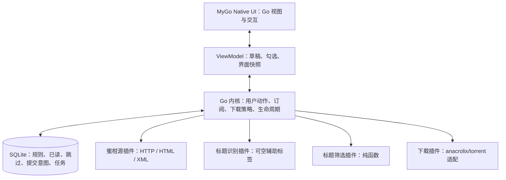

# Dipper V1 当前技术栈与剩余选型

- 需求依据：[PRD-v1.md](<PRD-v1.md>)。
- 决策依据：用户已确定 **MyGo Native UI + Go**，采用纯 Go 原生界面。
- 状态：桌面框架与语言已确认；下表其余项目为推荐默认方案。**BT 引擎、蜜柑历史遍历、Windows 原生界面与桌面生命周期已完成本机实测**，见 [验证总览](<VALIDATION-v1.md>)。
- 适用范围：本文是当前实施方向；[前期技术调研](<TECH-RESEARCH-v1.md>)保留数据源实证与候选比较，旧的 Tauri、Electron、Wails 和 Rust 推荐不再作为主方案。

## 1. 推荐组合

| 项目 | 当前选型 | 状态与依据 |
| --- | --- | --- |
| 桌面框架与 UI | MyGo Native UI、Go 的 ui 包 | 用户已确认；不依赖 WebView 构建主界面 |
| 编程语言与模块 | Go、Go Modules | 用户已确认；依赖固定版本并提交 go.sum |
| 应用结构 | 单进程模块化；长驻业务内核与界面分离 | 推荐；先减少进程和桥接，下载实现通过接口可替换 |
| BT 引擎 | github.com/anacrolix/torrent | **已验证**：共享限速、停止传输、关闭停止、断点恢复 sha256 一致、策略持久化均通过（见验证总览） |
| 本地数据库 | SQLite + database/sql + modernc.org/sqlite | 推荐；无需独立数据库服务，避免引入 cgo 数据库驱动 |
| 数据访问与迁移 | 显式 SQL、版本化迁移、go:embed | 推荐；V1 不增加 ORM，关键操作使用事务和唯一约束 |
| HTTP | net/http、context | 推荐；统一超时、代理、重试、缓存和同主机请求预算 |
| HTML | github.com/PuerkitoBio/goquery | 推荐；解析蜜柑目录、详情、字幕组关联和历史展开 |
| RSS | encoding/xml + 蜜柑专用结构 | 推荐；显式处理 torrent 扩展命名空间、大小与无时区时间 |
| 标题匹配 | 自有 Go 纯函数模块 | 推荐；界面预览与 RSS 自动下载复用同一实现 |
| 标题识别 | Go regexp / 字符串扫描 + 已知来源信息 | 推荐；只输出辅助字段、建议词和原文位置 |
| 插件 | Go interface + 内置注册表 + 生命周期 | 推荐；首版四类插件随应用编译并默认启用 |
| 调度 | context + goroutine + time.Timer + 可注入时钟 | 推荐；调度与页面独立，支持暂停、退避和完全退出 |
| UI 状态 | Go ViewModel / 状态快照 + 用户动作 | 推荐；后台事件通过受控通道更新，绘制回调不执行网络或数据库操作 |
| 日志 | log/slog + 本地轮转日志 | 推荐；关联订阅 ID、内容 ID、错误阶段，控制体积并避免记录凭据 |
| UI 测试 | testing + MyGo ui.NewTester | 推荐；交互、布局、焦点、主题、截图及虚拟时间回归 |
| 集成测试 | testing、httptest、临时数据库与目录、本地 BT peer | 推荐；真实解析/事务/引擎，外部来源由本地样本服务提供 |
| CI | GitHub Actions 三端矩阵 | 推荐；同一套用例在 Windows/macOS/Linux 分别执行 |
| 打包 | mygo build，纯原生项目使用 Go 工具入口和 JSON 配置 | 推荐；验证安装包、资源、系统依赖和架构 |
| 更新 | MyGo 签名更新机制与原生更新界面 | 推荐；发布源初期可选 GitHub Releases，密钥与发布账号另行配置 |

MyGo 和第三方库的具体 tag、Go 最低版本、传递依赖与 CGO_ENABLED=0 构建结果，在首个原型中共同锁定。主站文档不一定对应固定 tag；不能仅凭“框架无 cgo”推导整个应用所有依赖均无原生构建要求。

## 2. 真正需要优先验证的事项

### 2.1 BT 引擎（已实测通过）

anacrolix/torrent 提供 magnet/torrent、DHT/PEX、存储后端、统计、允许/禁止上传下载等接口，适合 Go 内核直接嵌入。其包元数据为 MPL-2.0，分发前核对锁定版本及依赖许可。[S01]

**本机实测已通过**（见[验证总览](<VALIDATION-v1.md>)）：3 任务共享 200 KiB/s 全局限速（各端约 73 KiB/s）、`DisallowDataDownload/Upload` 与 `Close` 后 payload 增量为 0、部分下载后新 client 恢复且 sha256 一致、做种策略持久化与虚拟时钟下的停止判定正确。

它是协议库，Dipper 仍需负责：

- 统一 client 中的全局上传预算，默认 1 MB/s；验证多任务、LAN、下载和做种阶段，不能对每任务各设 1 MB/s。
- 以稳定 BT 内容身份提交、暂停、重试和恢复；下载优先级变为零不自动等于停止上传。
- 将本次运行的统计增量累计到持久检查点；使用计数器 epoch/基线避免暂停或重启后重复累加。
- 下载完成后，以“累计上传 payload 达到累计下载 payload”或“有效做种 3,600 秒”先到者为停止条件。零下载量的已有文件情形需明确处理，不能直接除零。
- 从开始下载起累计上传量；有效做种时间仅在完成、允许做种、软件运行且网络可用时累计。
- 单独保存暂停和手动停止意图；正常退出停止网络但不将所有任务永久改成用户手动暂停。
- 校验原文件和元数据后恢复；停止做种不删除文件。

若该库未通过关键恢复/停止用例，可在同一下载接口下评估 libtorrent worker。更换下载引擎不重新打开 MyGo + Go 的框架决策，也不擅自要求用户安装外部下载器。

### 2.2 来源历史完整性（算法已证实）

**已实测证实**：端点 `GET /Home/ExpandEpisodeTable` 仅接受 `bangumiId`、`subtitleGroupId`、`take` 三个参数，**无 offset/page/cursor**；`take` 是绝对条数，终止条件为“返回行数 ≠ 请求的 take”（含 0 行，HTTP 始终 200）。长样本 227/161 实际 **1522 行 / 1522 唯一 id / 重复 0**；短样本 4063/370 为 3 行。**RSS 硬上限 100 条**，长番不能用 RSS 做历史全量初始化。

来源插件分别提供目录、详情、历史、RSS 和资源解析能力。实现时：初次订阅用**一次大 take（如 10000）**取全量，返回行数小于 take 即为完整；遇到行数等于 take 时翻倍重试。历史结果携带内部 completeness（完整/部分/未知）；只有满足终止条件才承诺“全部已有资源”。自动更新及暂停恢复只处理当时仍在 RSS 的条目，不额外补查历史。

RSS guid 样本为标题，不能做 BT 去重键；源站 Episode ID 和 BT hash 分开保存。实际 `.torrent` 或 magnet 确认的 info-hash 才用于最终内容去重。全站 PublishGroup ID 与番剧 RSS 的 subgroupid 也须分别建模。[S07–S11]

建议初始约 15 分钟轮询并抖动、同 URL 合并请求、限制同主机并发、按支持情况使用条件请求；这是产品默认建议，尚非核实的站点许可频率。429 遵循 Retry-After，故障退避；验证码或结构变化应显示来源错误，不能当成空列表。站点条款及合理使用边界仍需核对。

### 2.3 真实桌面 E2E 驱动（Windows 已实测通过）

**Windows 已实跑通过**：真实窗口可被外部 UI Automation 识别（`class=MyGoWindow`），外部读到 21 个 Text、33 个 Button、6 个 CheckBox；`Invoke` 词语按钮改变规则行，`Toggle` 复选框改变摘要并落盘；关闭窗口后进程存活，重启后选择状态恢复。

无窗口 Tester 可覆盖大量界面交互，但“一个系统跑一次”不代表三端均通过。测试应分三层：

| 层次 | 实现 | 验证范围 |
| --- | --- | --- |
| UI 回归 | ui.NewTester + 可注入服务、时钟 | 关键词、匹配原因、勾选、焦点、键盘、布局、动效与图像 |
| 应用集成 | 真实 Go 内核、SQLite、文件系统、HTTP 样本服务、BT client/peer | 规则到提交、落盘、故障、去重、退出与恢复 |
| 桌面 E2E | 启动构建产物，外部驱动真实窗口 | 实际输入法、系统对话框、托盘、完全退出及平台渲染 |

Windows 的 UI Automation 已实跑验证通过；macOS 评估 Accessibility/AX；Linux 评估 AT-SPI 驱动。MyGo 暴露可访问性名称/角色/状态，Windows 下驱动对其控件的读取与操作已实测可用，但另两端尚未实跑，不宣称已有统一的三端外部驱动。内部 Key 也不能直接当成对外 AutomationId。[S03][S04]

CI 一次提交触发三个系统分别测试；图像基线固定字体、DPI、窗口大小、主题和系统，不共用一张截图要求所有系统逐像素一致。UI 回归应自动执行，失败阻止合并/发布；配置 required checks 后再称为门禁。截图/录像供人工判断美观与易理解程度，不能代替自动断言。

## 3. 内核、状态与插件边界

内核不依赖 MyGo ui 类型，不使用界面计时器调度 RSS。窗口隐藏后内核继续运行；完全退出取消根 context、阻止新提交、停止网络、保存检查点并等待相关任务结束。用户的持久运行意图与引擎当前观测状态分别存储。

V1 用 interface 和注册表管理 discover/register、版本检查、init/start/stop 四类内置插件。资源源与下载插件返回结构化错误；识别失败输出未知；筛选异常不能当成匹配全部。插件不能自行删除内核的规则或历史。进程内插件不提供不可信代码的硬隔离；第三方安装市场、动态加载和沙箱留待未来，不使用依赖平台的 Go plugin 动态库作为首版机制。

界面采用统一颜色、间距、字号和动效 token，系统字体优先、中文字体回退、图标通过嵌入资源提供。遵循减少动态效果设置；图标集、字体分发和最终视觉风格在交互设计阶段确定，不另引入 Web 前端框架。

## 4. 数据一致性和规则

SQLite 由长驻内核拥有；不把持久状态绑在窗口或 UI 插件连接生命周期中。开启外键、busy timeout，采用短事务与明确的写入串行策略；建议本地 WAL、关键状态 synchronous=FULL，实际 SQLite 应包含官方 WAL-reset 修复。迁移前备份，并验证中断后的恢复。[S12]

建议实体：番剧、订阅、来源资源、BT 内容与 hash 别名、条目处理记录、提交意图、下载记录。关键约束：

- `(source_id, anime_id)` 识别番剧，目录映射持久化。
- `(subscription_id, source_item_id)` 记住条目是否 unread / filtered / skipped / submitted。
- `(hash_algorithm, hash_bytes)` 全局唯一；兼容 btih 十六进制/Base32 归一化，以及后续 v1/v2 hash 别名。
- 下载任务按内容 ID 唯一，不按标题或集数唯一。

匹配条目先落盘唯一提交意图，再幂等 EnsureTask；引擎接受后，事务保存任务并标记已提交/已读。提交失败保留未读。引擎接受但进程在落库前崩溃时，重放相同意图并复用同一目录；不能生成新任务身份。

初次订阅用完整历史快照保存规则、选中意图、取消条目的跳过记录和规则排除的已读记录，再启动 RSS；暂停时取消请求并在提交前检查订阅 revision，避免旧请求继续标记条目。调整规则不重扫已读。

匹配器保存 all_of、none_of、any_of_groups 和语义版本，预览/后台复用。建议规范为 ASCII 大小写不敏感、明确全角 ASCII 转半角，其余标点/空白保留，不做简繁转换和同义词扩展；这是待交互确认的默认建议。标签解析只辅助阅读和建议词，不能暗中限制下载。建议词有原文区间，默认排除集数。

## 5. 目录、日志与运行配置

默认根目录建议“系统下载目录 / Dipper”，允许修改并检查可写；无系统下载目录时使用用户主目录下 DipperDownloads。每番剧首次建立固定目录，跨字幕组复用；同名不同番剧区分。每资源使用稳定独立子目录，保留种子内文件名和相对结构，阻止路径逃逸和覆盖。

改变全局下载根目录只影响新订阅；现有番剧目录不重新推导、不搬动。缺失空间/权限等错误重试原任务；大小未知显示已知合计与未知条数，不伪造总量。

业务设置存 SQLite，启动资源/默认值用嵌入配置。日志和缓存放系统应用数据/缓存目录；日志带任务关联 ID、限体积轮转，诊断包避免包含凭据和不必要的用户路径。封面使用内存+磁盘缓存并设置容量，不引入单独缓存服务。

## 6. 打包、版本与发布

优先使用 MyGo 自带构建打包和签名更新，纯原生项目可使用 JSON 配置及 Go 工具入口，无需引入 Web 构建链。官方支持 Windows 安装器、macOS App/DMG、Linux 包/归档；交叉编译与目标平台签名、公证、系统验收是不同环节。[S05][S06]

建议首发验证目标：Windows 11 amd64；macOS arm64/amd64；Ubuntu 24.04 amd64，并补 KDE/Wayland 和 GNOME 托盘差异。最低系统版本和新增架构在构建/真机结果后锁定，不将“提供三个系统版本”等同支持全部 Linux 发行版。

MyGo 原生 UI 的 Linux 图形与托盘仍有系统库需求。分发文档的部分 Linux 包说明涉及 WebView，要对照固定 tag、纯原生实际产物确认依赖；不能笼统承诺零运行依赖。更新验证签名、用户可写安装位置和数据库迁移兼容；系统包管理器安装的版本按其更新机制处理。

CI 推荐 gofmt 检查、go vet、go test、适当的 race 与 fuzz、MyGo UI 回归、真实内核集成，随后三端安装产物冒烟。关键平台用例显式报告 skip，不把只构建当成已运行。正式发布前配置 required checks、签名和发布账号；此处尚未执行上传或发布。

## 7. 原型通过标准与下一步

1. **最小原生界面**：关键词点选、资源勾选、长标题和中文输入；Tester 自动测试、主题/缩放/截图；实际三端运行。
2. **下载链路**：自有小种子经真实本地 peer 下载；共享限速、上传停止、同名资源隔离、断电/杀进程恢复。
3. **业务状态**：重复 RSS/磁力只一个任务；取消勾选跨重启保持；提交失败仍未读；订阅暂停不影响已提交下载。
4. **做种策略**：25 分钟退出后继续剩余 35 分钟，或先达到 1:1；断网/休眠不累计，正常网络无下载者也累计；手停后不自动恢复。
5. **来源完整性**：验证蜜柑长篇历史的继续加载与终止规则，以及失败/验证码不显示为假空状态。
6. **桌面端到端**：实际窗口输入、托盘恢复、完全退出后无残留传输，重启恢复；验证至少一条外部驱动的操作链，再扩展三端。

最重要的未决项是 BT 引擎行为、完整历史接入和真实桌面 E2E 驱动。其余表中推荐可作为默认方向，不需要用户逐个批准普通 Go 库。若出现能力缺口，先替换对应适配层，不重新讨论已确认的框架选择。

## 8. 来源与验证边界

- [S01 anacrolix/torrent](https://pkg.go.dev/github.com/anacrolix/torrent)：本轮读到 v1.61.0 包页面并提示不一定是模块最新版本；有 magnet、统计、传输控制和存储接口，不代表本项目已通过恢复测试。
- [S02 goquery](https://pkg.go.dev/github.com/PuerkitoBio/goquery)：CSS 选择器解析 HTML；读取前处理编码，解析器不执行站点脚本。
- [S03 MyGo UI 测试](https://mygo.egoist.dev/docs/ui/testing)：无窗口交互、图像、布局和虚拟时间。
- [S04 MyGo 可访问性](https://mygo.egoist.dev/docs/ui/accessibility)：对外名称、角色、状态与操作；具体驱动需实测。
- [S05 MyGo 分发](https://mygo.egoist.dev/docs/distribution)：平台包、CGO 开关、资源与签名；部分步骤需要目标系统工具。
- [S06 MyGo 更新](https://mygo.egoist.dev/docs/updates)：签名清单、原生更新界面和安装位置限制。
- [S07 蜜柑 RSS 样本](https://mikanime.tv/RSS/Bangumi?bangumiId=4063&subgroupid=370)：前轮实际 XML，guid 为标题、扩展 pubDate 无时区、enclosure 为种子。
- [S08 蜜柑季度样本](https://mikanime.tv/Home/BangumiCoverFlowByDayOfWeek?year=2025&seasonStr=%E5%86%AC)：前轮实读 HTML，内部接口非正式 SLA API。
- [S09 蜜柑详情](https://mikanime.tv/Home/Bangumi/4063)：前轮实读字幕组与 RSS 关联。
- [S10 蜜柑长篇历史](https://mikanime.tv/Home/Bangumi/227)及[展开样本](https://mikanime.tv/Home/ExpandEpisodeTable?bangumiId=227&subtitleGroupId=161&take=30)：前轮读到首屏 15 条/展开 30 条，尚未证明全量遍历。
- [S11 蜜柑资源](https://mikanime.tv/Home/Episode/9dd7eb5c920bddd3cd46c9256decda56d3d36008)：前轮实读磁力与种子入口；未验证真实公网下载完成。
- [S12 SQLite WAL](https://www.sqlite.org/wal.html)：本机限制、同步与 WAL-reset 修复说明；实际 driver 连接的 SQLite 版本在原型记录。
- [S13 modernc.org/sqlite](https://pkg.go.dev/modernc.org/sqlite)：本轮页面返回 500；当前将其作为无 cgo 驱动推荐，具体版本需再核。前轮核实 Magpie 固定提交的依赖包含它，不能由此推导 Dipper 已构建通过。

本文件中的“已确认”仅指用户对 MyGo Native UI + Go 的技术方向决定；推荐依赖、默认参数和验证计划均没有被写成已经完成的实现。
