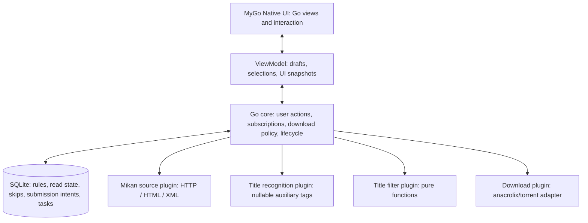

# Dipper V1 Current Tech Stack and Remaining Choices

- Requirements basis: [PRD-v1.md](<PRD-v1.md>).
- Decision basis: the user has confirmed **MyGo Native UI + Go**, using a pure Go native interface.
- Status: the desktop framework and language are confirmed; the remaining items in the table below are recommended defaults. **The BT engine, Mikan history traversal, the Windows native interface and the desktop lifecycle have been verified on this machine**; the measurements are in the tests that replaced them, chiefly `internal/downloader/` and `internal/source/`.
- Scope: this document is the current implementation direction. The earlier research that weighed Tauri, Electron, Qt, Wails and a Rust core was written before the stack was settled; those candidates are no longer the plan, and the data-source evidence that still matters is recorded in the [source subsystem page](docs/subsystems/source.md).

## 1. Recommended Stack

| Item | Current choice | Status and basis |
| --- | --- | --- |
| Desktop framework and UI | MyGo Native UI, Go's ui package | Confirmed by the user; the main interface is not built on WebView |
| Language and modules | Go, Go Modules | Confirmed by the user; dependencies are pinned to fixed versions and go.sum is committed |
| Application structure | Single-process, modular; long-running business core separated from the interface | Recommended; fewer processes and bridges first, and the download implementation is replaceable behind an interface |
| BT engine | github.com/anacrolix/torrent | **Verified**: shared rate limiting, stopping transfers, shutdown stop, sha256-identical resume and policy persistence all pass (see validation overview) |
| Local database | SQLite + database/sql + modernc.org/sqlite | Recommended; no separate database service and no cgo database driver |
| Data access and migrations | Explicit SQL, versioned migrations, go:embed | Recommended; V1 adds no ORM, and critical operations use transactions and unique constraints |
| HTTP | net/http, context | Recommended; uniform timeouts, proxy, retries, caching and per-host request budgets |
| HTML | github.com/PuerkitoBio/goquery | Recommended; parses Mikan catalogs, details, fansub group associations and history expansion |
| RSS | encoding/xml + Mikan-specific structs | Recommended; explicitly handles the torrent extension namespace, sizes and times without a time zone |
| Title matching | Own pure-function Go module | Recommended; the interface preview and automatic RSS download reuse the same implementation |
| Title recognition | Go regexp / string scanning + known source information | Recommended; outputs only auxiliary fields, suggested terms and source-text positions |
| Plugins | Go interface + built-in registry + lifecycle | Recommended; the first version's four plugin kinds compile with the app and are enabled by default |
| Scheduling | context + goroutine + time.Timer + injectable clock | Recommended; scheduling is independent of pages and supports pause, backoff and full exit |
| UI state | Go ViewModel / state snapshots + user actions | Recommended; background events update through controlled channels, and draw callbacks perform no network or database work |
| Logging | log/slog + local rotating logs | Recommended; correlates subscription IDs, content IDs and failure stages, bounds size and avoids logging credentials |
| UI testing | testing + MyGo ui.NewTester | Recommended; interaction, layout, focus, theme, screenshot and virtual-time regression |
| Integration testing | testing, httptest, temporary databases and directories, local BT peer | Recommended; real parsing/transactions/engine, with external sources served by local sample services |
| CI | GitHub Actions three-platform matrix | Recommended; the same test suite runs separately on Windows/macOS/Linux |
| Packaging | mygo build; pure-native projects use the Go tool entry point and JSON configuration | Recommended; verify installers, resources, system dependencies and architectures |
| Updates | MyGo signed update mechanism and native update interface | Recommended; GitHub Releases is an initial option for the release source, with keys and release accounts configured separately |

The exact MyGo and third-party tags, the minimum Go version, transitive dependencies and the CGO_ENABLED=0 build result are all pinned together in the first prototype. The main site documentation does not necessarily match a fixed tag; "the framework has no cgo" alone does not imply that every dependency of the whole application has no native build requirements.

## 2. Items That Genuinely Need Verification First

### 2.1 BT Engine (verified on this machine)

anacrolix/torrent provides interfaces for magnet/torrent, DHT/PEX, storage backends, statistics, and allowing/disallowing uploads and downloads, which makes it suitable for direct embedding in a Go core. Its package metadata lists MPL-2.0; check the pinned version and dependency licenses before distribution. [S01]

**Verified on this machine**: 3 tasks share a 200 KiB/s global rate limit (about 73 KiB/s each), payload growth is 0 after `DisallowDataDownload/Upload` and after `Close`, a new client resumes after a partial download with matching sha256, and seeding policy persistence and the stop decision under a virtual clock are correct. These now run as `internal/downloader` tests rather than as a one-off measurement.

It is a protocol library; Dipper must still handle:

- A global upload budget in the shared client, 1 MB/s by default; verify it across multiple tasks, LAN, download and seeding phases, rather than setting 1 MB/s per task.
- Submit, pause, retry and resume against a stable BT content identity; a download priority of zero does not automatically mean uploads stop.
- Accumulate this run's statistics deltas into persistent checkpoints; use counter epochs/baselines to avoid double-counting after a pause or restart.
- After a download completes, stop on whichever comes first: "cumulative uploaded payload reaches cumulative downloaded payload" or "3,600 seconds of effective seeding". The existing-file case with zero download volume needs explicit handling; do not divide by zero.
- Count uploaded volume from the start of the download; effective seeding time accrues only when the download is complete, seeding is allowed, the app is running and the network is available.
- Store pause and manual-stop intents separately; a normal exit stops networking without permanently turning every task into a user manual pause.
- Verify the original files and metadata before resuming; stopping seeding does not delete files.

If the library fails critical resume/stop cases, a libtorrent worker can be evaluated behind the same download interface. Changing the download engine does not reopen the MyGo + Go framework decision, nor does it unilaterally require users to install an external downloader.

### 2.2 Source History Completeness (algorithm proven)

**Proven by measurement**: the endpoint `GET /Home/ExpandEpisodeTable` accepts only three parameters — `bangumiId`, `subtitleGroupId` and `take` — and has **no offset/page/cursor**; `take` is an absolute row count, and the termination condition is "returned rows ≠ requested take" (including 0 rows, with HTTP always 200). The long sample 227/161 actually returns **1522 rows / 1522 unique ids / 0 duplicates**; the short sample 4063/370 returns 3 rows. **RSS has a hard cap of 100 entries**, so a long-running anime cannot use RSS for full historical initialization.

The source plugin provides catalog, detail, history, RSS and release parsing capabilities separately. When implementing: initial subscription uses **one large take (e.g. 10000)** to fetch everything, and fewer returned rows than the take means completeness; when the row count equals the take, retry with double the take. History results carry an internal completeness state (complete/partial/unknown); only when the termination condition is met may "all existing releases" be promised. Automatic updates and pause recovery process only entries still in RSS at that time and do not backfill history.

In the RSS samples the guid is the title, so it cannot serve as a BT deduplication key; store the source site's Episode ID and the BT hash separately. Only the info-hash confirmed by an actual `.torrent` or magnet is used for final content deduplication. The site-wide PublishGroup ID and the anime RSS subgroupid must also be modeled separately. [S07–S11]

Suggested initial behavior: poll about every 15 minutes with jitter, coalesce requests for the same URL, limit per-host concurrency and use conditional requests where supported. These are product defaults, not a verified site-permitted frequency. Honor Retry-After on 429 and back off on failures; a captcha or structural change must surface as a source error, not as an empty list. Site terms and reasonable-use boundaries still need review.

### 2.3 Real Desktop E2E Driver (Windows verified on this machine)

**Windows passes an actual run**: the real window is discoverable by external UI Automation (`class=MyGoWindow`), and an external reader sees 21 Text, 33 Button and 6 CheckBox controls; `Invoke` on a term button changes the rule row, and `Toggle` on a checkbox changes the summary and persists it; after the window closes the process stays alive, and the selection state is restored after restart.

A windowless Tester covers many interface interactions, but "one run on one system" does not mean all three platforms pass. Tests should be split into three layers:

| Layer | Implementation | Coverage |
| --- | --- | --- |
| UI regression | ui.NewTester + injectable services and clock | Keywords, match reasons, checkboxes, focus, keyboard, layout, animation and images |
| Application integration | Real Go core, SQLite, filesystem, HTTP sample services, BT client/peer | Rule to submission, persistence, failures, deduplication, exit and recovery |
| Desktop E2E | Launch the build artifact and drive the real window externally | Real IME, system dialogs, tray, full exit and platform rendering |

Windows UI Automation is verified by an actual run; macOS will be evaluated with Accessibility/AX and Linux with an AT-SPI driver. MyGo exposes accessibility name/role/state, and on Windows the driver's reading and manipulation of its controls is verified in practice, but the other two platforms have not been run, so no unified three-platform external driver is claimed. Internal Key values also cannot be treated directly as external AutomationIds. [S03][S04]

One CI commit triggers separate test runs on three systems; image baselines fix fonts, DPI, window size, theme and OS, and a single screenshot is not shared as a pixel-identical requirement across all systems. UI regression should run automatically, with failures blocking merge/release; call it a gate only after required checks are configured. Screenshots and recordings support human judgement of visual quality and comprehensibility and cannot replace automated assertions.

## 3. Core, State and Plugin Boundaries

The core does not depend on MyGo ui types and does not use interface timers to schedule RSS. The core keeps running while the window is hidden; a full exit cancels the root context, blocks new submissions, stops networking, saves checkpoints and waits for the relevant tasks to finish. The user's persistent run intent and the engine's current observed state are stored separately.

V1 uses interfaces and a registry to manage four kinds of built-in plugins: discover/register, version check, and init/start/stop. Source and download plugins return structured errors; recognition failure reports unknown; a filter error must not be treated as matching everything. Plugins cannot delete the core's rules or history on their own. In-process plugins provide no hard isolation for untrusted code; a third-party marketplace, dynamic loading and sandboxing are left for the future, and platform-dependent Go plugin dynamic libraries are not used as the first-version mechanism.

The interface uses unified color, spacing, type-size and animation tokens, prefers system fonts with a Chinese font fallback, and serves icons from embedded resources. It honors the reduce-motion setting; the icon set, font distribution and final visual style are settled during interaction design, without introducing a separate web frontend framework.

## 4. Data Consistency and Rules

SQLite is owned by the long-running core; persistent state is not tied to the window or UI plugin connection lifecycle. Enable foreign keys and busy timeout, and use short transactions with an explicit write-serialization strategy; local WAL and synchronous=FULL for critical state are recommended, and the actual SQLite build should include the official WAL-reset fix. Back up before migrations and verify recovery after an interruption. [S12]

Suggested entities: anime, subscription, source release, BT content and hash aliases, item processing records, submission intents, download records. Key constraints:

- `(source_id, anime_id)` identifies anime, and the catalog mapping is persisted.
- `(subscription_id, source_item_id)` records whether an item is unread / filtered / skipped / submitted.
- `(hash_algorithm, hash_bytes)` is globally unique; support btih hex/Base32 normalization and later v1/v2 hash aliases.
- Download tasks are unique by content ID, not by title or episode number.

A matched item first persists a unique submission intent, then calls EnsureTask idempotently; once the engine accepts, a transaction saves the task and marks it submitted/read. A failed submission stays unread. If the engine accepts but the process crashes before the write, replay the same intent and reuse the same directory; a new task identity must not be created.

Initial subscription uses a full history snapshot to store rules, selected intents, skip records for deselected items and read records for rule-excluded items, then starts RSS; on pause, cancel requests and check the subscription revision before submission so stale requests cannot keep marking items. Changing rules does not rescan read items.

The matcher stores all_of, none_of, any_of_groups and a semantic version, reused by both preview and background. Suggested normalization: ASCII case-insensitive, with explicit full-width ASCII to half-width conversion, other punctuation/whitespace preserved, and no simplified/traditional conversion or synonym expansion; this is a default pending interaction confirmation. Tag parsing only aids reading and suggested terms and must not silently restrict downloads. Suggested terms carry source-text ranges and exclude episode numbers by default.

## 5. Directories, Logs and Runtime Configuration

The suggested default root is "system downloads directory / Dipper", changeable, with a writability check; when there is no system downloads directory, use DipperDownloads under the user's home directory. Each anime gets a fixed directory on first creation, reused across fansub groups; anime with the same name are kept distinct. Each release uses a stable dedicated subdirectory that preserves file names and relative structure inside the torrent, preventing path escapes and overwrites.

Changing the global download root affects only new subscriptions; existing anime directories are neither re-derived nor moved. Errors such as missing space or permissions retry the original task; when sizes are unknown, show the known subtotal and the count of unknown entries rather than fabricating a total.

Business settings live in SQLite, and startup resources/defaults use embedded configuration. Logs and caches go to the system application data/cache directories; logs carry task correlation IDs and rotate by size limit, and diagnostic bundles avoid credentials and unnecessary user paths. Covers use memory + disk caches with capacity limits, with no separate cache service.

## 6. Packaging, Versioning and Release

Prefer MyGo's built-in build packaging and signed updates; pure-native projects can use JSON configuration and the Go tool entry point without a web build chain. Officially supported targets are Windows installers, macOS App/DMG and Linux packages/archives; cross-compilation, target-platform signing, notarization and system acceptance are separate stages. [S05][S06]

Suggested first-release verification targets: Windows 11 amd64; macOS arm64/amd64; Ubuntu 24.04 amd64, plus KDE/Wayland and GNOME tray differences. Minimum OS versions and additional architectures are pinned after build/real-hardware results; "three OS builds" is not equivalent to supporting every Linux distribution.

The Linux graphics and tray for MyGo Native UI still require system libraries. Some Linux package notes in the distribution docs involve WebView, so confirm dependencies against the pinned tag and the actual pure-native artifact; do not promise zero runtime dependencies in general. Verify update signatures, user-writable install locations and database migration compatibility; versions installed through system package managers follow their own update mechanism.

CI should run gofmt checks, go vet, go test, appropriate race and fuzz runs, MyGo UI regression and real-core integration, followed by smoke tests of the three platform installers. Critical platform cases report skip explicitly; a build alone is not treated as a run. Configure required checks, signing and release accounts before an official release; no upload or release has been performed here.

## 7. Prototype Pass Criteria and Next Steps

1. **Minimal native interface**: keyword selection, release checkboxes, long titles and Chinese input; automated Tester runs, theme/scaling/screenshots; actual runs on three platforms.
2. **Download path**: an own small torrent downloaded through a real local peer; shared rate limiting, upload stop, same-name release isolation, recovery after power loss/kill.
3. **Business state**: duplicate RSS/magnet entries produce only one task; deselection survives restart; a failed submission stays unread; pausing a subscription does not affect submitted downloads.
4. **Seeding policy**: exiting after 25 minutes continues the remaining 35 minutes, or reaches 1:1 first; offline/sleep does not accrue, while a normal network with no downloaders does accrue; manual stop does not auto-resume.
5. **Source completeness**: verify continued loading and termination rules for long Mikan histories, and that failures/captchas do not appear as a fake empty state.
6. **Desktop end-to-end**: real window input, tray restore, no residual transfers after a full exit, recovery after restart; verify at least one externally driven operation chain, then extend to three platforms.

The most important open items are BT engine behavior, full-history integration and the real desktop E2E driver. The remaining recommendations in the table can serve as default directions without requiring the user to approve each ordinary Go library. If a capability gap appears, replace the corresponding adapter layer first rather than reopening the confirmed framework choice.

## 8. Sources and Verification Boundaries

- [S01 anacrolix/torrent](https://pkg.go.dev/github.com/anacrolix/torrent): this round read the v1.61.0 package page, which notes that it is not necessarily the module's latest version; it provides magnet, statistics, transfer control and storage interfaces, which does not mean this project has passed resume tests.
- [S02 goquery](https://pkg.go.dev/github.com/PuerkitoBio/goquery): parses HTML with CSS selectors; handle encoding before reading, and the parser does not execute site scripts.
- [S03 MyGo UI testing](https://mygo.egoist.dev/docs/ui/testing): windowless interaction, images, layout and virtual time.
- [S04 MyGo accessibility](https://mygo.egoist.dev/docs/ui/accessibility): external names, roles, states and actions; the specific driver needs real testing.
- [S05 MyGo distribution](https://mygo.egoist.dev/docs/distribution): platform packages, CGO switches, resources and signing; some steps require target-system tools.
- [S06 MyGo updates](https://mygo.egoist.dev/docs/updates): signed manifests, the native update interface and install-location restrictions.
- [S07 Mikan RSS sample](https://mikanime.tv/RSS/Bangumi?bangumiId=4063&subgroupid=370): actual XML from an earlier round; the guid is the title, the extended pubDate has no time zone and the enclosure is the torrent.
- [S08 Mikan season sample](https://mikanime.tv/Home/BangumiCoverFlowByDayOfWeek?year=2025&seasonStr=%E5%86%AC): HTML actually read in an earlier round; internal interfaces are not a formal SLA API.
- [S09 Mikan details](https://mikanime.tv/Home/Bangumi/4063): fansub group and RSS associations actually read in an earlier round.
- [S10 Mikan long history](https://mikanime.tv/Home/Bangumi/227) and the [expansion sample](https://mikanime.tv/Home/ExpandEpisodeTable?bangumiId=227&subtitleGroupId=161&take=30): an earlier round read 15 first-screen rows / 30 expanded rows; full traversal is not yet proven.
- [S11 Mikan release](https://mikanime.tv/Home/Episode/9dd7eb5c920bddd3cd46c9256decda56d3d36008): magnet and torrent entry points actually read in an earlier round; a real public-network download completion is not verified.
- [S12 SQLite WAL](https://www.sqlite.org/wal.html): notes on local limits, synchronization and the WAL-reset fix; the SQLite version the actual driver connects to is recorded in the prototype.
- [S13 modernc.org/sqlite](https://pkg.go.dev/modernc.org/sqlite): the page returned 500 this round; it is currently recommended as a cgo-free driver, and the exact version needs re-checking. An earlier round confirmed that Magpie's pinned commit includes it as a dependency, which does not imply Dipper already builds with it.

"Confirmed" in this document refers only to the user's decision on the MyGo Native UI + Go technical direction; recommended dependencies, default parameters and verification plans are not written as completed implementations.
